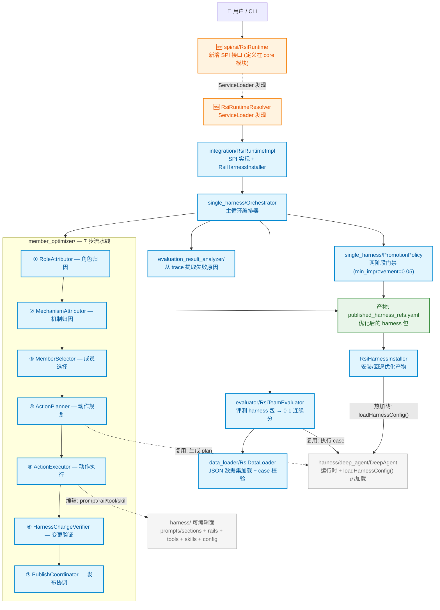

# agent-core-java RSI 模块功能设计文档

> 版本：v1.0
> 日期：2026-11-17
> 作者：齐活林（交付总监）
> 关联文档：`RSI-Python模块依赖分析报告-v1.md`、`RSI-Java模块现状与改造方案-v1.md`、`RSI-jiuwenswarm实现归类分析-v1.md`、`RSI-jiuwenswarm两层架构职责拆解-v1.md`

---

## 1. 需求背景 【必选】

### 1.1 现状与问题 【必选】

- **问题1**：Java 版 agent-core-java 完全不存在 RSI（递归自我改进）模块。Python 版 agent-core 已有完整的 RSI 实现（`openjiuwen/rsi/`，含 harness_rsi C 类主链路 + artifact_rsi A 类能力 + 公共 schema，总计 100+ 文件），Java 版零代码覆盖 → Java 版 agent 无法自动优化 harness 包（prompt sections/rails/tools/skills），只能人工调参 → 无法实现递归自我改进闭环。
- **问题2**：Java 版已有 harness 可编辑面（19 个 prompt section 类、16+ rail 类、14+ tool 类、harness_config YAML schema），但没有自动优化这些可编辑面的引擎 → 可编辑面只能手工编辑，无法基于评测结果自动归因失败原因并改进。
- **问题3**：Java 版已有两套评测器（`agentevolving/evaluator/` 面向 RL 训练、`dev_tools/tune/evaluator/` 面向调参），但都缺少 RSI 需要的连续分数评测 + 两阶段晋级门禁 + 输入冻结指纹机制 → 无法支撑 RSI 的"评测→归因→改进→门禁→晋级"迭代闭环。

### 1.2 同类产品 / 参考实现调研 【可选】

| 能力 | 实现方式 | 关键类/模块 | 来源 |
|------|---------|-------------|------|
| Harness 迭代优化（C 类） | 冻结 case 集 → 评测 → 归因 → 规划 → 执行 → 门禁 → 晋级 | `SingleHarnessIterativeOptimizationOrchestrator`, `MemberOptimizer`, `PromotionPolicy` | Python agent-core 源码走读 |
| RSI 产物热加载 | `deepAgent.loadHarnessConfig()` + `RuntimeExtensionLoader` | `DeepAgent.loadHarnessConfig()`, `enqueueHarnessConfig()` | Java agent-core-java 源码 |
| SPI 插件化 | `ServiceLoader` + `META-INF/services/` 注册 | `MemoryRuntime`, `MemoryRuntimeResolver`, `KVStoreProvider` | Java agent-core-java 源码 |
| RRSI 七层正则化 | 历史条件提议 + 编辑预算 + 停滞重定向 + 批评者预筛 + 噪声下限 + 成本规则 + 剪枝 | `_rejected_capabilities()`, `max_actions_per_plan`, `feedback.py`, `verification.py` | Python agent-core 源码 + RSI 技术洞察报告 |

**对本方案的启示**：Python RSI 的 harness_rsi 对 core+harness 有 60+ 处硬依赖（语义级组合，非接口级调用），无法整体独立抽取。Java 版应新建独立模块，通过 SPI 接口解耦，复用现有 harness 可编辑面和 DeepAgent，不修改任何现有类。

### 1.3 自家产品现状对照 【可选】

| 能力 | Python 版 | Java 版（现状） | 本期目标 | 复用/新建 |
|------|-----------|---------------|---------|----------|
| RSI 公共 schema | ✅ `rsi/schema.py` + `rsi/events.py` | ❌ | 新建 | 新建 |
| Harness 迭代优化编排器 | ✅ `SingleHarnessIterativeOptimizationOrchestrator` | ❌ | 新建 | 新建 |
| 两阶段晋级门禁 | ✅ `PromotionPolicy` + `continuous.py` | ❌ | 新建 | 新建 |
| 评测器（TeamEvaluator） | ✅ `evaluator/`（20+ 文件） | ⚠️ 有 RL 评测器但不适用 | 新建 RsiTeamEvaluator | 新建 |
| 成员优化器 7 步流水线 | ✅ `member_optimizer/`（20+ 文件） | ❌ | 新建 | 新建 |
| harness 可编辑面 | ✅ prompt/rail/tool/skill/config | ✅ 19 sections + 16 rails + 14 tools | 复用 | 复用 |
| DeepAgent 运行时 | ✅ `create_deep_agent` | ✅ `HarnessFactory.createDeepAgent()` | 复用 | 复用 |
| 产物热加载 | ✅ `load_plugin_package()` | ✅ `deepAgent.loadHarnessConfig()` | 复用 | 复用 |
| SPI 插件化 | ❌ | ✅ `ServiceLoader` 体系 | 复用 | 复用 |
| artifact_rsi（A 类） | ✅ program_opt + paper_opt | ❌ | 本期不做 | — |

---

## 2. 价值 / 设计动机 【必选】

1. **技术自主性**：Java 版 agent-core-java 具备递归自我改进能力，不再依赖 Python 版运行 RSI 优化流程 —— 对应问题 #1
2. **效率提升**：harness 包的 prompt/rail/tool/skill 可编辑面可基于评测数据自动优化，减少人工调参成本 —— 对应问题 #2
3. **架构一致性**：RSI 作为独立 Maven 模块 + SPI 插件按需加载，与 retrieval/memory 模块一致，不侵入 core 代码 —— 对应问题 #1
4. **产物可热加载**：RSI 演进产物通过现有 `loadHarnessConfig()` 热加载，不需要重启进程 —— 对应问题 #1

---

## 3. 设计目标与非目标 【必选】

### 3.1 设计目标 【必选】

| 目标编号 | 目标 | 说明 | 验证方式 |
|---------|------|------|---------|
| G1 | 独立 Maven 模块 | 新增 `agent-core-rsi-java` 模块，通过 SPI 按需加载 | pom.xml 模块声明 + `META-INF/services/` 注册 + 不引入 RSI jar 时 core 无感知 |
| G2 | 单 Harness 迭代优化闭环 | 加载数据集 → 评测 baseline → 归因 → 规划 → 执行 → 门禁 → 晋级 | 用 3+ case 的数据集跑 2 轮迭代，门禁判定逻辑正确 |
| G3 | 两阶段晋级门禁 | 目标 batch 提分 + 全量重放不退分 + sha256 指纹校验 | 构造退分 case 验证门禁拒绝；构造提分 case 验证门禁通过 |
| G4 | 产物热加载 | RSI 产出的优化 harness 包通过 `deepAgent.loadHarnessConfig()` 热加载 | 优化前后 prompt section 内容变化在下次 stream() 中生效 |
| G5 | 零侵入现有代码 | 不修改 core 模块任何现有类 | git diff 确认 core 模块无改动 |
| G6 | action 白名单 | 只允许 prompt/config/rail/skill/tool 五类可编辑面 | 构造非法 action_group 验证拒绝 |

### 3.2 非目标 【必选】

| 非目标编号 | 排除项 | 排除原因 |
|-----------|--------|---------|
| NG1 | artifact_rsi（A 类能力） | program_opt（MCTS）+ paper_opt（auto_research）共 90+ 文件，与 harness_rsi 独立，后续视需求再实现 |
| NG2 | auto_harness（B 类改源码） | Python 的 `harness_rsi/auto_harness/` 是改 agent-core 源码的流水线，递归深度更深，本期只做 C 类 |
| NG3 | improver_evolution（策略进化） | Python 有 `improver_evolution/policy.py` 做改进器策略自动演化，本期用固定策略 |
| NG4 | noise_floor / cost_rule 正则化 | Python RSI 只实现了 RRSI 七层正则化中的约三层，缺噪声下限和成本规则，本期不补 |

---

## 4. 需求范围 【必选】

### 4.1 本期支持范围（In Scope） 【必选】

| # | 内容 | 落点 | 场景 |
|---|------|------|------|
| S1 | RSI 公共 Schema | `rsi/schema/` | S1 |
| S2 | 数据集加载与校验 | `rsi/harness_rsi/data_loader/` | S1 |
| S3 | RSI 评测器 | `rsi/harness_rsi/evaluator/` | S1 |
| S4 | 评测结果分析器 | `rsi/harness_rsi/evaluation_result_analyzer/` | S1 |
| S5 | 两阶段晋级门禁 | `rsi/harness_rsi/single_harness/PromotionPolicy.java` | S1 |
| S6 | 迭代优化编排器 | `rsi/harness_rsi/single_harness/SingleHarnessIterativeOptimizationOrchestrator.java` | S1 |
| S7 | 成员优化器 7 步流水线 | `rsi/harness_rsi/member_optimizer/` | S1 |
| S8 | action group 白名单 | `rsi/harness_rsi/member_optimizer/action_groups/` | S1 |
| S9 | SPI 接口与实现 | `core/spi/rsi/` + `rsi/integration/` | S2 |
| S10 | 产物热加载集成 | `rsi/integration/RsiHarnessInstaller.java` | S2 |

### 4.2 本期不支持范围（Out of Scope） 【必选】

| # | 排除项 | 说明 |
|---|--------|------|
| O1 | artifact_rsi（program_opt/paper_opt） | 下期增量 |
| O2 | auto_harness（B 类改源码流水线） | 待评审定稿 |
| O3 | improver_evolution（策略进化） | 后续视 Phase 2 效果决定 |
| O4 | 多 Harness 协同优化 | 本期只做单 Harness（single_harness 模式） |

---

## 5. 场景定义 【可选】

| # | 场景 | 触发原因 | 进程状态 | 状态完整度 | 恢复入口 | 恢复决策 |
|---|------|---------|---------|-----------|---------|---------|
| S1 | RSI 优化任务执行 | 用户提交数据集 + harness 包，启动优化 | RUNNING | 完整 state 持久化 | `RsiRuntime.resume(taskId)` | 从 epoch checkpoint 恢复 |
| S2 | 优化产物热加载 | 优化任务完成，用户安装发布产物 | 运行中 | 产物已发布 | `deepAgent.loadHarnessConfig()` | 直接热加载，不重启 |
| S3 | 优化产物回退 | 用户回退到历史版本 | 运行中 | 历史版本保留 | `RsiRuntime.rollback(installationId)` | 卸载当前版本 → 加载历史版本 |

---

## 6. 总体设计 【必选】

### 6.1 架构总览 【必选】



**核心流程说明**：

1. 用户通过 `RsiRuntime` SPI 接口提交优化任务（数据集 + harness 包路径）
2. `SingleHarnessIterativeOptimizationOrchestrator` 执行迭代循环：评测 → 分析 → 归因 → 规划 → 执行 → 门禁 → 晋级
3. 产出的优化 harness 包通过 `RsiHarnessInstaller` 调用 `deepAgent.loadHarnessConfig()` 热加载
4. 不引入 RSI jar 时，`RsiRuntimeResolver.find()` 返回 `Optional.empty()`，core 完全不感知 RSI

**图例**：蓝色 = RSI 新增模块，橙色 = 新增 SPI 接口，灰色 = 现有模块。实线箭头 = 调用/复用关系，虚线箭头 = SPI ServiceLoader 发现。

### 6.2 职责边界 【必选】

| 机制/组件 | 职责 | 粒度 | 时机 |
|----------|------|------|------|
| `RsiRuntime` (SPI) | 对外入口：启动/暂停/查询任务 | 任务级 | 用户调用 |
| `SingleHarnessIterativeOptimizationOrchestrator` | 迭代循环编排 | epoch 级 | 任务执行中 |
| `RsiTeamEvaluator` | 评测 harness 包，输出 0-1 连续分 | case 级 | 每个 epoch 的评测阶段 |
| `EvaluationResultAnalyzer` | 从评测 trace 提取失败原因 | case 级 | 评测完成后 |
| `MemberOptimizer` | 7 步流水线优化 harness 包 | role + action 级 | 归因完成后 |
| `PromotionPolicy` | 两阶段门禁判定（目标 batch + 全量重放） | epoch 级 | 候选评测完成后 |
| `RsiHarnessInstaller` | 安装/回退优化产物，调用热加载 | 版本级 | 任务完成后 |

### 6.3 与既有模块的关系 【必选】

| 模块 | 相关性 |
|------|--------|
| `harness/deep_agent/DeepAgent` | 复用：RSI 评测器和 ActionPlanner 调用 DeepAgent 执行 case / 生成 plan |
| `harness/harness_config/HarnessConfig` | 复用：RSI 读写 HarnessConfig 作为优化目标 |
| `harness/prompts/sections/*` | 复用：ActionExecutor 编辑 prompt sections |
| `harness/rails/*` | 复用：ActionExecutor 通过 `registerRail`/`unregisterRail` 增删 rails |
| `harness/tools/skills/*` | 复用：ActionExecutor 编辑 skills |
| `agentevolving/evaluator/BaseEvaluator` | 并存：RSI 评测器独立实现，不复用（评测模型不同） |
| `auto_harness/AutoHarnessOrchestrator` | 并存：RSI 有自己的 orchestrator，不复用（避免耦合） |
| `spi/memory/MemoryRuntime` | 参考：SPI 插件化模式与 memory 模块一致 |

---

## 7. 详细方案设计 【必选】

### 7.1 核心抽象设计 【必选】

#### 7.1.1 SPI 接口（定义在 core 模块）

```java
// core/src/main/java/com/openjiuwen/spi/rsi/RsiRuntime.java
/**
 * Host contract for the RSI optimization runtime.
 * Discovered via {@link java.util.ServiceLoader} when agent-core-rsi-java is installed.
 * @since 0.2.0
 */
public interface RsiRuntime {
    /** Start an optimization task. Returns a task handle for async tracking. */
    RsiTaskHandle startOptimization(RsiTaskRequest request);

    /** Query current task state. Returns empty if task not found. */
    Optional<RsiTaskState> getState(String taskId);

    /** Read the best harness refs path produced by a completed task. */
    Optional<String> getBestHarnessRefs(String taskId);

    /** Install the published harness as the active version (hot-load). */
    void installPublishedHarness(String taskId);

    /** Rollback to a historical installation version. */
    void rollback(String installationId);

    /** List all retained installation versions. */
    List<RsiInstallationVersion> listVersions();
}
```

```java
// core/src/main/java/com/openjiuwen/spi/rsi/RsiRuntimeResolver.java
public final class RsiRuntimeResolver {
    private RsiRuntimeResolver() {}

    /** Find the single available RSI runtime, or empty when not installed. */
    public static Optional<RsiRuntime> find() {
        Iterator<RsiRuntime> runtimes = ServiceLoader.load(RsiRuntime.class).iterator();
        if (!runtimes.hasNext()) {
            return Optional.empty();
        }
        return Optional.of(runtimes.next());
    }
}
```

#### 7.1.2 RSI 数据契约

```java
// rsi/schema/RsiSchema.java
public enum RsiScenario { HARNESS, ARTIFACT }
public enum RsiStatus { CREATED, QUEUED, RUNNING, COMPLETED, FAILED, PAUSED, TERMINATED }

public record RsiTaskRequest(
    RsiScenario scenario,           // HARNESS（C类）
    String name,
    String datasetFile,             // JSON 数据集路径
    String harnessRefsPath,         // 待优化的 harness 包引用
    String outputDir,               // 输出目录
    Map<String,String> modelRefs,   // optimizer/tester 模型引用
    int maxIterations               // 最大 epoch 数
) {}

public record RsiTaskHandle(String taskId, RsiStatus status) {}

public record RsiTaskState(
    String taskId, RsiStatus status, int iteration, int totalIterations,
    Double bestScore, Double baselineScore, String updatedAt,
    String error, String bestHarnessRefsPath
) {}
```

#### 7.1.3 迭代请求与结果

```java
// rsi/harness_rsi/single_harness/IterativeSingleHarnessRequest.java
public record IterativeSingleHarnessRequest(
    List<String> datasetFiles,      // 数据集文件路径列表
    String harnessRefsPath,         // 待优化的 harness 包引用
    String outputDir,               // 输出目录
    String datasetId,               // 数据集标识
    boolean resume,                 // 断点续跑
    boolean autoFullBaseline,       // 自动测 H0 基线
    String taskId,
    int maxIteration                // 最大 epoch 数
) {}
```

```java
// rsi/harness_rsi/single_harness/IterativeSingleHarnessResult.java
public record IterativeSingleHarnessResult(
    String statePath,               // → single_harness_state.yaml
    String reportPath,              // → single_harness_report.yaml
    String currentHarnessRefsPath,  // 当前激活的 harness 包
    String bestHarnessRefsPath,     // 最佳验证通过的 harness 包
    String publishedHarnessRefsPath,// 发布到稳定位置的 harness 包
    Double bestScore                // 最佳分数
) {}
```

#### 7.1.4 推广策略

```java
// rsi/harness_rsi/single_harness/PromotionPolicy.java
public class PromotionPolicy {
    private static final double EPSILON = 1e-9;
    private final double minImprovement;          // 默认 0.05
    private final double nonTargetMaxRegression;  // 默认 0.05

    /**
     * Two-stage promotion decision:
     * Stage 1: target cases must improve by >= minImprovement
     * Stage 2: full evaluation, non-target cases must not regress beyond threshold
     */
    public PromotionResult evaluate(
        Map<String,Double> candidateScores,
        Map<String,Double> baselineScores,
        Set<String> targetCaseIds,
        ImprovementProof proof
    ) {
        // Stage 1: target cases improved
        boolean targetsImproved = true;
        for (String caseId : targetCaseIds) {
            double delta = candidateScores.get(caseId) - baselineScores.get(caseId);
            if (delta <= minImprovement + EPSILON) {
                targetsImproved = false;
                break;
            }
        }
        if (!targetsImproved) {
            return PromotionResult.rejected("target_cases_not_improved");
        }
        // Stage 2: full evaluation, non-target regression check
        for (String caseId : candidateScores.keySet()) {
            if (targetCaseIds.contains(caseId)) continue;
            double regression = baselineScores.get(caseId) - candidateScores.get(caseId);
            if (regression > nonTargetMaxRegression + EPSILON) {
                return PromotionResult.rejected("non_target_case_regressed: " + caseId);
            }
        }
        // Full mean score must strictly improve
        double candidateMean = meanScore(candidateScores);
        double baselineMean = meanScore(baselineScores);
        if (candidateMean <= baselineMean + EPSILON) {
            return PromotionResult.rejected("mean_score_not_improved");
        }
        return PromotionResult.accepted(candidateMean - baselineMean);
    }

    public static double meanScore(Map<String,Double> scores) {
        return scores.values().stream()
            .mapToDouble(Double::doubleValue)
            .average().orElse(0.0);
    }
}
```

**关键决策说明**：

1. **门禁阈值 0.05 是绝对阈值**：与 Python 版一致，不做评估方差建模（已知缺口，对应 RRSI 第 5 层"噪声下限"未实现）。
2. **proof 结构含 sha256 指纹**：`ImprovementProof` 包含 `packageFingerprint`、`baselineScoresDigest`、`qualified`，防止评测期间包体被篡改。
3. **两阶段串行**：先跑目标 batch（只跑失败 case），通过后再跑全量重放——避免全量评测浪费算力。

#### 7.1.5 成员优化器

```java
// rsi/harness_rsi/member_optimizer/MemberOptimizer.java
public class MemberOptimizer {
    private final RoleAttributor roleAttributor;
    private final MechanismAttributor mechanismAttributor;
    private final MemberSelector memberSelector;
    private final ActionPlanner actionPlanner;
    private final ActionExecutor actionExecutor;
    private final HarnessChangeVerifier verifier;
    private final PublishCoordinator publisher;

    /**
     * 7-step optimization pipeline:
     * 1. RoleAttributor     → which role has the problem?
     * 2. MechanismAttributor → which component of the role? (prompt/tool/rail/skill/config)
     * 3. MemberSelector     → deterministic scoring, select top-N roles (no LLM)
     * 4. ActionPlanner      → DeepAgent generates structured plan (5 action groups × add/modify/remove)
     * 5. ActionExecutor     → execute plan on harness package (git worktree isolated)
     * 6. HarnessChangeVerifier → AST-level static validation + safety blacklist
     * 7. PublishCoordinator → merge to current_harnesses + update refs
     */
    public MemberOptimizationArtifact optimize(
        EvaluationResultAnalysisArtifact analysis,
        String harnessRefsPath
    ) { /* ... */ }
}
```

#### 7.1.6 Action Group 白名单

```java
// rsi/harness_rsi/member_optimizer/action_groups/ActionGroupPolicy.java
public class ActionGroupPolicy {
    // RSI allows only 5 editable surfaces (same as Python)
    public static final Set<String> ALLOWED_ACTION_GROUPS =
        Set.of("prompt", "config", "rail", "skill", "tool");
    public static final Set<String> ALLOWED_OPERATIONS =
        Set.of("add", "modify", "remove", "search");
    // single_harness mode: only prompt_section surface allowed
    public static final Set<String> ALLOWED_PROMPT_SURFACES =
        Set.of("prompt_section");

    public static void validate(MemberOptimizationAction action) {
        if (!ALLOWED_ACTION_GROUPS.contains(action.group())) {
            throw new ActionPlanRejectedException("action_group not allowed: " + action.group());
        }
        if (!ALLOWED_OPERATIONS.contains(action.operation())) {
            throw new ActionPlanRejectedException("operation not allowed: " + action.operation());
        }
        // Path prefix must match action group
        validatePathPrefix(action);
    }
}
```

### 7.2 核心流程设计 【必选】

**迭代优化主循环**：

1. **输入冻结**：`RsiTaskMaterializer` 复制数据集和 harness 包各一份快照 + sha256 指纹，本次运行只读快照。—— 防止评测期间输入被篡改。
2. **Baseline 评测**：`RsiTeamEvaluator` 用源 harness 包跑全量 case，输出 baseline 分数（0-1 连续分），写入 `baseline_eval_ref.yaml`。
3. **Epoch 循环**（`maxIteration` 次）：
   - 3a. **评测结果分析**：`EvaluationResultAnalyzer` 从 trace 提取 `TeamIssue` 列表（失败原因 + evidence）。
   - 3b. **成员优化器 7 步流水线**：`MemberOptimizer.optimize()` 产出优化后的 harness 包候选。
   - 3c. **门禁 Stage 1（目标 batch）**：只跑失败的 case，验证目标 case 提分 ≥ 0.05。通过则进 Stage 2。
   - 3d. **门禁 Stage 2（全量重放）**：跑全部 case，验证非目标 case 退分 ≤ 0.05 + 全量均分严格提高。通过则晋级。
   - 3e. **指纹校验**：门禁前后各校验一次 `packageFingerprint()`，不一致抛异常。
   - 3f. **Checkpoint**：写入 `epoch_checkpoints`，更新 `best_harness_refs_path`。
4. **最终发布**：`_ensure_final_publication()` 把 best harness 包复制到 `published/` 目录，写 `current_harness_refs.yaml`。
5. **热加载**（用户触发）：`RsiHarnessInstaller.install()` 调用 `deepAgent.loadHarnessConfig(publishedConfigPath)`，卸载旧 rails/tools/skills → 加载新资源。

**异常路径**：
- 门禁 Stage 1 拒绝 → 候选丢弃，不消耗全量评测算力，进入下一 epoch。
- 门禁 Stage 2 拒绝 → 候选丢弃，记入 `optimization_journal`（outcome=improved_but_rejected），下一 epoch 以原 best 为起点。
- 无候选通过门禁 → `publication_status = "not_published_no_improvement"`，不发布。

### 7.3 扩展点设计 【可选】

| 扩展点 | 接口 | 调用时机 | 信任边界 | 默认策略 |
|--------|------|---------|---------|---------|
| RSI 运行时 | `RsiRuntime` (SPI) | 用户调用 RSI 功能时 | 同进程 | 不安装 RSI jar 时返回 empty |
| 评测器后端 | `RsiEvaluatorBackend` | 评测 case 时 | 同进程 | DeepAgent 后端 |
| 判定器 | `Judger` (SPI) | 评测打分时 | 同进程 | LLM-as-Judge（连续分数模式） |
| Action 规划器 | `ActionPlanner` (interface) | 规划改动时 | 同进程 | DeepAgent 驱动 |

### 7.4 产物热加载详细设计

RSI 产物的热加载复用 Java 版 DeepAgent 已有的三套机制：

| 方法 | 用途 | 调用时机 |
|------|------|---------|
| `deepAgent.loadHarnessConfig(path)` | 直接热加载 harness_config.yaml | 安装优化产物时 |
| `deepAgent.enqueueHarnessConfig(path)` | 入队，下次 stream() 前消费 | 异步安装 |
| `deepAgent.registerRail(rail)` / `unregisterRail(rail)` | 动态增删 rail | 替换 rail 时 |
| `skillUseRail.reloadSkills()` | 重新扫描 skill 目录 | 更新 skill 时 |

**加载链路**：`RsiHarnessInstaller.install(taskId)` → 解析 `published_harness_refs.yaml` → 读取包目录的 `harness_config.yaml` → `deepAgent.loadHarnessConfig(configPath)` → `doLoadHarnessConfig()` 内部先 `unloadRails/unloadTools/unloadSkillDirs`（按旧 YAML 声明逆操作卸载），再 `loadRails/loadTools/loadSkillDirs`（按新 YAML 加载）——**是替换不是叠加**。

**热加载边界**：
- ✅ prompt sections / skill 定义 / tool 描述 / harness_config.yaml → 热加载
- ⚠️ rail 逻辑（Java 类）→ 同 Class 实例可替换；新 Class 字节码需自定义 ClassLoader
- ❌ 不可热加载的场景：改了 rail/tool 的 `.class` 文件（需重启 JVM）——但 RSI 不改字节码，只改 YAML/MD/脚本

---

## 8. 对外接口设计 【必选】

| API | 语义 | 调用方 | 可见性 |
|-----|------|--------|--------|
| `RsiRuntime.startOptimization(request)` | 启动 RSI 优化任务 | 应用层 / CLI | 公开 |
| `RsiRuntime.getState(taskId)` | 查询任务状态 | 应用层 / 监控 | 公开 |
| `RsiRuntime.getBestHarnessRefs(taskId)` | 读取最佳 harness 引用 | 应用层 | 公开 |
| `RsiRuntime.installPublishedHarness(taskId)` | 安装优化产物（热加载） | 应用层 / CLI | 公开 |
| `RsiRuntime.rollback(installationId)` | 回退到历史版本 | 应用层 / CLI | 公开 |
| `RsiRuntime.listVersions()` | 列出所有保留版本 | 应用层 / CLI | 公开 |
| `RsiRuntimeResolver.find()` | SPI 发现 RSI 运行时 | core 内部 | 内部 |
| `deepAgent.loadHarnessConfig(path)` | 热加载 harness 配置 | RsiHarnessInstaller | 内部 |
| `deepAgent.enqueueHarnessConfig(path)` | 队列式热加载 | RsiHarnessInstaller | 内部 |

---

## 9. 数据模型设计 【可选】

RSI 不引入数据库，所有状态以 YAML/JSON 文件落盘（与 Python 版一致）。

| 文件 | 格式 | 内容 |
|------|------|------|
| `single_harness_state.yaml` | YAML | 完整运行状态：epoch 检查点、候选门禁记录、分数轨迹 |
| `single_harness_report.yaml` | YAML | 人类可读报告：baseline/best 分数、候选数/接受数 |
| `optimization_journal.yaml` | YAML | 实验日志：每轮 lever/outcome/surface |
| `lever_scoreboard.yaml` | YAML | 杠杆记分板：各 lever 的成功/失败统计 |
| `harness_refs.yaml` | YAML | harness 包引用：`{harness_refs: {role: path}}` |
| `member_optimization_ref.yaml` | YAML | 单轮优化完整 artifact 索引 |
| `eval_ref.yaml` | YAML | 评测结果：每个 case 的 0-1 分数 + trace |

---

## 10. 配置设计 【可选】

| 配置项 | 默认值 | 说明 | 热更新 |
|--------|--------|------|--------|
| `rsi.enabled` | false | 是否启用 RSI 模块 | 否（SPI 发现） |
| `rsi.promotion.min_improvement` | 0.05 | 目标 case 最小提分阈值 | 是 |
| `rsi.promotion.non_target_max_regression` | 0.05 | 非目标 case 最大退分容忍 | 是 |
| `rsi.optimizer.max_roles_per_run` | 1 | 单次运行最大优化角色数 | 是 |
| `rsi.optimizer.max_actions_per_plan` | 3 | 单次规划最大动作数 | 是 |
| `rsi.optimizer.allowed_action_groups` | prompt,config,rail,skill,tool | 允许的可编辑面 | 是 |
| `rsi.optimizer.allowed_prompt_surfaces` | prompt_section | 允许的 prompt 编辑面 | 是 |
| `rsi.evaluator.score_mode` | continuous | 评测分数模式 | 否 |
| `rsi.evaluator.solver_max_iterations` | 300 | DeepAgent 最大迭代数 | 是 |

---

## 11. 异常与边界设计 【必选】

| 场景 | 预期行为 |
|------|---------|
| RSI jar 未安装，用户调用 RSI 功能 | `RsiRuntimeResolver.find()` 返回 empty，抛 `RsiNotInstalledException` |
| 数据集 case_id 为空或重复 | `RsiDataLoader.load()` 抛 `IllegalArgumentException` |
| harness_refs.yaml 引用多个角色 | `_validateSingleHarnessRefs()` 抛异常（single_harness 模式只允许 1 个角色） |
| 门禁 Stage 1 目标 case 未提分 | 拒绝候选，不消耗 Stage 2 算力 |
| 门禁 Stage 2 非目标 case 退分超阈值 | 拒绝候选，记入 journal（outcome=improved_but_rejected） |
| 评测期间 harness 包被篡改 | sha256 指纹不匹配，抛 `EvaluationInfrastructureError` |
| ActionPlanner 生成非法 action_group | `ActionGroupPolicy.validate()` 抛 `ActionPlanRejectedException`，触发反馈重试 |
| ActionPlanner 重试超 `max_attempts` | 抛 `ActionPlanRejectedError`，该 epoch 跳过 |
| ActionExecutor 路径逃逸 | `_validateWorktreePath()` 拒绝，路径必须在 role worktree root 内 |
| 优化产物 hot-load 时 manifest.json 损坏 | `load_plugin_package()` 抛异常，安装回退到上一版本 |
| 并发：多个 RSI 任务同时运行 | `RsiTaskStore` 7 态状态机校验合法迁移，非法迁移抛 `TaskStateConflictException` |
| 断点续跑：输入指纹不匹配 | 抛异常，防止用户在续跑前换了数据集或 harness 包 |

---

## 12. 安全设计 【可选】

- **路径安全**：ActionExecutor 的每个写路径必须在 role worktree root 内（`resolve` 后 `relative_to` 检查），且不能包含 `current_harnesses`、`.publish_tmp` 等受保护目录。
- **Action 白名单**：`ActionGroupPolicy` 硬编码 5 类可编辑面（prompt/config/rail/skill/tool），不允许修改 agent 自身源码——这是 C 类和 B 类的分界线。
- **AST 安全检查**：`HarnessChangeVerifier` 对 rail 代码做 AST 级别静态分析，禁止 `eval`/`exec`/`subprocess`/`os.system` 等危险调用。
- **技能脚本黑名单**：`.bat`/`.cmd`/`.dll`/`.exe`/`.ps1`/`.sh`/`.so` 后缀直接拒绝。
- **输入冻结**：数据集和 harness 包各复制一份快照 + sha256，评测期间只读快照。

---

## 13. 实施规划 【必选】

| # | 任务 | 归属模块 | 依赖 | 备注 |
|---|------|---------|------|------|
| T1 | RSI 公共 Schema | `rsi/schema/` | - | 15 个 record/enum |
| T2 | SPI 接口定义 | `core/spi/rsi/` | T1 | RsiRuntime + Resolver |
| T3 | Harness RSI Schema | `rsi/harness_rsi/` | T1 | ActionDefinition, TeamIssue, DatasetArtifact |
| T4 | 配置类 | `rsi/harness_rsi/config/` | T1 | EvaluatorConfig, MemberOptimizerConfig |
| T5 | 数据集加载器 | `rsi/harness_rsi/data_loader/` | T3 | JSON 加载 + case 校验 |
| T6 | 推广策略 | `rsi/harness_rsi/single_harness/` | T3 | 两阶段门禁 + sha256 |
| T7 | RSI 评测器 | `rsi/harness_rsi/evaluator/` | T4,T5 | 复用 DeepAgent |
| T8 | 迭代编排器 | `rsi/harness_rsi/single_harness/` | T6,T7 | 主循环 |
| T9 | ActionPlanner + ActionExecutor | `rsi/harness_rsi/member_optimizer/` | T3 | 复用 DeepAgent |
| T10 | MemberOptimizer facade | `rsi/harness_rsi/member_optimizer/` | T9 | MVP 3 步版 |
| T11 | SPI 实现 | `rsi/integration/` | T8,T10 | RsiRuntimeImpl |
| T12 | RsiHarnessInstaller | `rsi/integration/` | T11 | 热加载集成 |
| T13 | RoleAttributor + MechanismAttributor | `rsi/harness_rsi/member_optimizer/` | T10 | LLM-as-Judge |
| T14 | MemberSelector | `rsi/harness_rsi/member_optimizer/` | T13 | 确定性打分排序 |
| T15 | HarnessChangeVerifier | `rsi/harness_rsi/member_optimizer/` | T9 | AST 静态校验 |
| T16 | PublishCoordinator | `rsi/harness_rsi/member_optimizer/` | T15 | 合并发布 |
| T17 | EvaluationResultAnalyzer | `rsi/harness_rsi/evaluation_result_analyzer/` | T7 | trace 分析 |
| T18 | 完善 7 步流水线整合 | `rsi/harness_rsi/member_optimizer/` | T13-T17 | 整合 |

---

## 14. 验收标准 【必选】

- [ ] 不引入 RSI jar 时，core 模块编译通过且运行不报错（G1/G5）
- [ ] 引入 RSI jar 后，`RsiRuntimeResolver.find()` 返回非 empty（G1）
- [ ] 用 3+ case 数据集跑 2 轮迭代，baseline 分数和候选分数正确输出（G2）
- [ ] 构造目标 case 退分场景，门禁 Stage 1 拒绝（G3）
- [ ] 构造非目标 case 退分超 0.05 场景，门禁 Stage 2 拒绝（G3）
- [ ] 构造提分场景，门禁通过且 `best_harness_refs_path` 更新（G3）
- [ ] 评测前后 sha256 指纹校验通过（G3）
- [ ] 构造非法 action_group（如 "source_code"），`ActionGroupPolicy` 拒绝（G6）
- [ ] 优化产物通过 `deepAgent.loadHarnessConfig()` 热加载，prompt section 内容在下次 stream() 中生效（G4）
- [ ] git diff 确认 core 模块现有文件无改动（G5）
- [ ] 回退功能：安装版本 A → 优化为 B → 回退到 A，A 的 prompt section 生效（G4）

---

## 15. 测试策略 【可选】

1. **UT**：`PromotionPolicy` 两阶段判定（纯函数，覆盖提分/退分/边界）；`ActionGroupPolicy` 白名单校验（覆盖合法/非法 group/operation/path）；`RsiDataLoader` case 校验（空/重复/格式错误）
2. **IT**：`SingleHarnessIterativeOptimizationOrchestrator` 端到端跑 2 轮迭代（mock 评测器返回预设分数）；`RsiHarnessInstaller` 热加载后 DeepAgent 的 prompt section 变化可见；SPI 发现机制（有/无 jar 两种场景）
3. **E2E**：用真实 DeepAgent + 真实 LLM 跑一个 3-case 的 CSV 日期格式化任务，验证 RSI 能自动发现 prompt 缺失并添加消歧规则，门禁通过并发布

---

## 16. 反模式对照 【可选】

| 反模式 | 本方案的规避 |
|--------|-------------|
| RSI 修改 agent 自身源码（B 类） | `ActionGroupPolicy` 硬编码 5 类可编辑面，源码不在白名单——这是 C 类和 B 类的分界线 |
| 评测器用 binary LLM 评分 | `PromotionPolicy` 要求连续分数，binary 评分被 `completeScores()` 直接拒绝 |
| 评测期间 harness 包被改 | 输入冻结（快照 + sha256），门禁前后各校验一次指纹 |
| ActionPlanner 无限重试 | `max_attempts=10` 上限，超限抛 `ActionPlanRejectedError` |
| 优化产物累积叠加 | `loadHarnessConfig` 先 unload 旧资源再 load 新资源——是替换不是叠加 |
| RSI 深度耦合 core | SPI 接口解耦，core 只定义接口不依赖实现 |

---

## 17. 风险与决策记录 【必选】

| 决策/风险 | 选择与应对 | 依据 |
|-----------|-----------|------|
| RSI 评测器不复用现有 RL 评测器 | 新建 `RsiTeamEvaluator` | 现有评测器面向 RL 训练，评测模型不同（RSI 需要 Team Skill + member harness 组合评测 + 连续分数 + 两阶段门禁） |
| ActionPlanner 复用 DeepAgent | 直接调用 `HarnessFactory.createDeepAgent()` | Python 版同样用 DeepAgent 驱动，Java 版已有完整实现，最大复用点 |
| auto_harness 不复用现有 | RSI 新建自己的 orchestrator | Python RSI 的 auto_harness 是 RSI 专用版本，与原版有差异，复用会引入耦合 |
| 门禁阈值 0.05 是绝对阈值 | 不做评估方差建模 | 与 Python 版一致（已知缺口，对应 RRSI 第 5 层"噪声下限"未实现） |
| 缺成本规则（RRSI 第 6 层） | `usage_recorder` 只记账不参与判定 | 与 Python 版一致；长时间运行 harness 会单调膨胀，后续补 |
| artifact_rsi 延后 | Phase 3 视需求再实现 | paper_opt 60+ 文件、program_opt 30+ 文件，与 harness_rsi 独立 |
| RSI 风险：判分器方差接近 0.05 | 会持续接受噪声级"改进" | 已知风险，P0 改进项：把评估方差接进门禁判定 |

---

## 18. 开放问题 【可选】

1. ~~RSI 是否做成独立 Maven 模块？~~ → 已决定：是，与 retrieval/memory 一致的 SPI 插件模式。
2. ~~RSI 产物是否支持热加载？~~ → 已决定：是，复用 `deepAgent.loadHarnessConfig()`。
3. Java 版是否有 `git worktree` 隔离能力？需要确认 JGit 或命令行 git 是否可用——影响 ActionExecutor 的隔离实现。
4. 判分器（Judger）用 LLM-as-Judge 还是脚本判定？取决于 case 类型，可能需要 `JudgerRegistry` 支持多种判定策略。
5. 多 Harness 协同优化何时支持？本期只做单 Harness，后续视需求评估。

---

## 19. 交付清单 【可选】

| 交付物 | 状态 |
|--------|:----:|
| RSI Python 模块依赖分析报告 | 已完成 |
| RSI Java 模块现状与改造方案报告 | 已完成 |
| agent-core-java RSI 功能设计文档（本文档） | 已完成 |
| `agent-core-rsi-java` Maven 模块骨架 | 规划 |
| Phase 1 MVP 代码实现 | 规划 |
| Phase 2 完整功能实现 | 规划 |
| 单元测试 | 规划 |
| 集成测试 | 规划 |

---

## 20. 类与文件索引 【可选】

### 新增文件（agent-core-rsi-java 模块）

| 类/文件 | 路径 | 角色 |
|---------|------|------|
| `RsiRuntime` | `core/src/main/java/com/openjiuwen/spi/rsi/RsiRuntime.java` | SPI 接口定义 |
| `RsiRuntimeResolver` | `core/src/main/java/com/openjiuwen/spi/rsi/RsiRuntimeResolver.java` | SPI 发现 |
| `RsiSchema` | `rsi/schema/RsiSchema.java` | 公共数据契约 |
| `SingleHarnessIterativeOptimizationOrchestrator` | `rsi/harness_rsi/single_harness/` | 主循环编排器 |
| `PromotionPolicy` | `rsi/harness_rsi/single_harness/` | 两阶段门禁 |
| `MemberOptimizer` | `rsi/harness_rsi/member_optimizer/` | 7 步流水线 facade |
| `ActionPlanner` | `rsi/harness_rsi/member_optimizer/` | 动作规划接口 |
| `ActionExecutor` | `rsi/harness_rsi/member_optimizer/` | 动作执行接口 |
| `ActionGroupPolicy` | `rsi/harness_rsi/member_optimizer/action_groups/` | 白名单校验 |
| `RsiTeamEvaluator` | `rsi/harness_rsi/evaluator/` | RSI 评测器 |
| `RsiDataLoader` | `rsi/harness_rsi/data_loader/` | 数据集加载 |
| `RsiHarnessInstaller` | `rsi/integration/` | 产物热加载 |
| `RsiRuntimeImpl` | `rsi/integration/` | SPI 实现 |

### 复用的现有文件（core 模块，不修改）

| 类/文件 | 路径 | 角色 |
|---------|------|------|
| `DeepAgent` | `harness/deep_agent/DeepAgent.java` | agent 运行时（评测 + 规划） |
| `HarnessFactory` | `harness/factory/HarnessFactory.java` | DeepAgent 工厂 |
| `HarnessConfig` | `harness/harness_config/HarnessConfig.java` | harness 配置 schema |
| `HarnessConfigLoader` | `harness/harness_config/HarnessConfigLoader.java` | 配置加载器 |
| `SkillUseRail` | `harness/rails/skills/SkillUseRail.java` | skill 热重载 |
| `MemoryRuntime` | `spi/memory/MemoryRuntime.java` | SPI 模式参考 |

---

## 21. 术语表 【可选】

| 术语 | 定义 |
|------|------|
| RSI | Recursive Self-Improvement，递归自我改进 |
| Harness | Agent 的配置包（prompt sections + rails + tools + skills + config） |
| C 类 | Harness 递归改进（改 harness 包，不改模型权重，不改源码） |
| B 类 | 自我修改代码库（改 agent 源码） |
| A 类 | 种群进化搜索（如 MCTS/PUCT 树搜索） |
| D 类 | 权重更新（如 LoRA/RLHF） |
| RRSI | Regularized RSI，带正则化约束的 RSI（七层正则化） |
| epoch | 一次完整的"评测→归因→规划→执行→门禁"循环 |
| 门禁 | 候选 harness 包通过两阶段判定才能晋级的机制 |
| 可编辑面 | RSI 允许修改的 harness 组件类型：prompt/config/rail/skill/tool |
| Lever | 杠杆，action_group 的抽象层级映射：instruction/action/control/configuration |
| 热加载 | 不重启进程的情况下加载新配置/资源 |
| SPI | Service Provider Interface，Java 标准的插件发现机制 |
