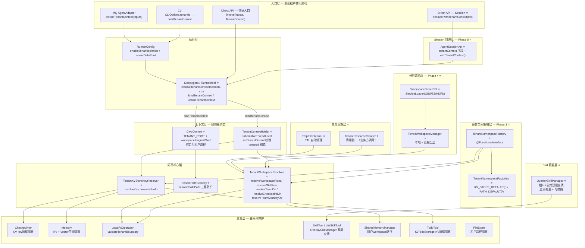
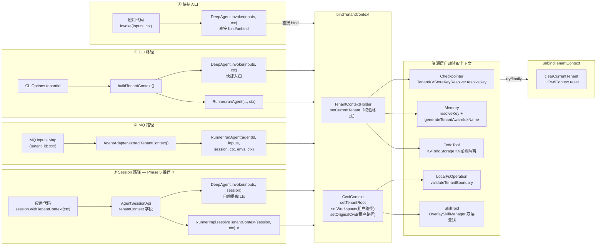

# agent-core-java 多租户数据隔离设计规格（整合版）

> 整合来源：多租户数据隔离设计规格.md + agent-core-java-multitenant-resource-brainstorming.md
> 冲突处理：以 brainstorming 文档（已与业务方核对确认）为准
> 整合日期：2026-07-20

---

## 〇、架构总览

### 0.1 多租户数据隔离整体架构



> ⭐ 标记的组件为多租户隔离新增的核心组件，构成隔离的"信任边界"。

### 0.2 tenant_id 端到端传递链路



> **关键设计**：所有入口最终汇聚到 `bindTenantContext()` → 设置 `TenantContextHolder`（含格式校验）+ 将 `CwdContext` 的 workspace/originalCwd/tenantRoot 绑定为租户路径 → 资源层组件自动从上下文读取租户信息 → 执行完毕后 `unbindTenantContext()` 清除上下文。

---

## 一、需求概述

### 1.1 问题陈述

当前 DeepAgent 框架在超级智能体场景中采用单例模型创建实体，共享统一的 workspace/tmp 目录作为工作空间。在多租户企业客户场景下，存在数据隔离不足的问题：

1. 不同租户共享同一个实例工作空间及 tmp 临时目录，可能导致租户之间临时文件互相访问或写入干扰
2. skill 目录当前对所有请求上下文可见，无法基于租户粒度隔离
3. 从智能体入口进入智能体后台后，系统只能感知不同 session，缺少基于租户 ID 的数据隔离能力
4. 企业多租户场景下，不同租户之间可能发生数据越界访问，不满足客户合规要求

### 1.2 期望行为

1. DeepAgent 支持基于请求参数中的租户 ID（tenantId）进行数据隔离
2. 租户粒度由业务方决定，可以是个人、部门或其他业务维度；框架内不感知具体业务概念
3. 框架不负责租户合法性校验，不判断用户是否属于某个租户
4. 框架仅根据 tenantId：拉取该租户已有数据，或在数据不存在时创建新的租户数据空间
5. 需隔离的数据：租户维度的 skill 数据、租户运行过程中临时生成的文件、租户工作空间中的临时写入数据
6. 不需隔离的数据：智能体配置文件、运行日志等公共运维类数据

### 1.3 验收标准

1. 不同 tenantId 之间无法访问彼此的 skill 数据
2. 不同 tenantId 之间无法访问彼此临时生成的文件
3. 不同 tenantId 之间的临时写入不会互相影响
4. 携带已有 tenantId 时，DeepAgent 能正确加载该租户对应的数据空间
5. 携带新的 tenantId 且数据不存在时，DeepAgent 能创建新的租户数据空间
6. 不能通过路径拼接、相对路径、软链接等方式访问其他租户的数据目录
7. 框架不依赖个人、部门等业务字段即可完成租户数据隔离

---

## 二、方案决策

### 2.1 架构模式选择

经过对比分析，选择 **无状态动态隔离 + 混合渐进式实施**（方案 C）：

| 决策项 | 选择 | 理由 |
|--------|------|------|
| 隔离模式 | 无状态动态隔离（上下文透传） | 与 agent-core-java 现有 Session/ThreadLocal 体系对齐，内存占用低，水平扩展友好 |
| tenantId 传入方式 | 调用参数显式传入 | 框架不自动推断租户身份，调用方明确传入更安全可追溯 |
| tenantId 格式约束 | 仅允许 `[a-zA-Z0-9_-]` | `safeTenantId()` 存碰撞风险，要求业务方合规传入，在 `setCurrentTenant()` 中校验 |
| Skill 隔离粒度 | 公共 + 租户双层（OverlaySkillManager） | 显式覆盖 + 可撤销，优于隐式同名覆盖 |
| 向后兼容策略 | 完全向后兼容 | 不传 tenantId 时行为与现有完全一致，零迁移风险 |
| 租户生命周期 | 框架只做数据空间隔离，不做租户管理 | 创建/注销由业务方负责，框架提供清理接口 |

### 2.2 方案对比（排除方案）

| 方案 | 排除理由 |
|------|----------|
| 多实例隔离（TenantAgentManager） | 每个租户一个 DeepAgent 实例，内存占用高（O(N)），扩展受限，并发模型复杂 |
| NamespaceFactory 全量重构（方案 B） | 改动量大（~20+ 类），涉及核心层重构，TieredWorkspaceManager 需新存储 SPI，风险高 |

---

## 三、租户定义与核心数据模型

### 3.1 TenantContext — 租户上下文

```java
package com.openjiuwen.core.multitenant;

import lombok.Data;
import lombok.Builder;
import java.util.Map;

@Data
@Builder
public class TenantContext {
    private final String tenantId;
    private final Map<String, String> extensions;

    public boolean isTenantAware() {
        return tenantId != null && !tenantId.isEmpty();
    }

    public String safeTenantId() {
        if (tenantId == null) return null;
        String sanitized = tenantId.replaceAll("[^a-zA-Z0-9_\\-]", "_");
        if (sanitized.isEmpty()) return null;
        return sanitized;
    }
}
```

**设计要点**：

- `tenantId` 是业务方定义的**不透明标识符**，框架不赋予任何业务语义（可能是个人、部门、组织或其他维度）
- `safeTenantId()` 仅做字符规范化（非安全字符替换为 `_`），作为**最后一道防线**（防御路径穿越等极端场景），不应作为字符碰撞的依赖手段
- `extensions` Map 留给业务方传递自定义元数据（如 region 等），框架内部**不使用**，不用于表达租户层级关系
- `isTenantAware()` 决定是否走隔离逻辑；不传 tenantId 时返回 false → 向后兼容
- **保持平面模型**，不引入层级租户（TenantHierarchy）

### 3.2 safeTenantId 碰撞风险与约束

`safeTenantId()` 将非 `[a-zA-Z0-9_-]` 的字符统一替换为 `_`，存在碰撞风险：

| 原始 tenantId | safeTenantId | 碰撞？ |
|--------------|-------------|--------|
| `dept-01` | `dept_01` | — |
| `dept.01` | `dept_01` | ⚠️ 与 `dept-01` 碰撞 |

**决策：** 要求业务方 tenantId **仅使用 `[a-zA-Z0-9_-]` 字符**，在 `TenantContextHolder.setCurrentTenant()` 中校验，不合规的 tenantId 抛出 `IllegalArgumentException`。

### 3.3 TenantContextHolder — 线程级上下文传播

```java
package com.openjiuwen.core.multitenant;

public final class TenantContextHolder {
    private static final InheritableThreadLocal<TenantContext> CURRENT_TENANT;

    public static TenantContext getCurrentTenant() { return CURRENT_TENANT.get(); }

    public static void setCurrentTenant(TenantContext ctx) {
        if (ctx != null && ctx.isTenantAware()) {
            String tid = ctx.getTenantId();
            if (!tid.matches("[a-zA-Z0-9_-]+")) {
                throw new IllegalArgumentException(
                    "tenantId must only contain [a-zA-Z0-9_-], got: " + tid);
            }
        }
        CURRENT_TENANT.set(ctx);
    }

    public static void clearCurrentTenant() { CURRENT_TENANT.remove(); }
}
```

**设计对齐**：与现有 `SessionContextHolder` 模式一致，使用 `InheritableThreadLocal` 使子任务/子 Agent 自动继承租户上下文。**新增格式校验**，不合规 tenantId 抛异常。

**InheritableThreadLocal 已知限制**（详见第八章）：
- ✅ `new Thread()` 创建的子线程自动继承
- ❌ 线程池复用的线程不会重新继承
- ❌ Reactor `Schedulers.boundedElastic()` 不继承
- ❌ `CompletableFuture` 默认 ForkJoinPool 不继承

### 3.4 TenantWorkspaceResolver — 租户目录解析与安全管理

> **⚠️ 关键修改**：`tenants/{tenantId}/` **就是**该租户的 workspace 目录，不需要 `/workspace` 子目录。

```java
package com.openjiuwen.core.multitenant;

import java.nio.file.*;
import java.util.concurrent.*;

public class TenantWorkspaceResolver {
    private final String baseWorkspacePath;
    private final ConcurrentMap<String, Path> initializedTenants = new ConcurrentHashMap<>();

    public Path resolveWorkspaceRoot(TenantContext ctx) {
        if (!ctx.isTenantAware()) {
            return Path.of(baseWorkspacePath).toAbsolutePath().normalize();
        }
        return Path.of(baseWorkspacePath, "tenants", ctx.safeTenantId())
                   .toAbsolutePath().normalize();
    }

    public Path resolveSkillRoot(TenantContext ctx) {
        if (!ctx.isTenantAware()) {
            return Path.of(baseWorkspacePath, "skills").toAbsolutePath().normalize();
        }
        return Path.of(baseWorkspacePath, "tenants", ctx.safeTenantId(), "skills")
                   .toAbsolutePath().normalize();
    }

    public Path resolveTempDir(TenantContext ctx) {
        if (!ctx.isTenantAware()) {
            return Path.of(baseWorkspacePath, "tmp").toAbsolutePath().normalize();
        }
        return Path.of(baseWorkspacePath, "tenants", ctx.safeTenantId(), "tmp")
                   .toAbsolutePath().normalize();
    }

    public Path resolveCheckpointDir(TenantContext ctx) {
        if (!ctx.isTenantAware()) {
            return Path.of(baseWorkspacePath, "checkpoints").toAbsolutePath().normalize();
        }
        return Path.of(baseWorkspacePath, "tenants", ctx.safeTenantId(), "checkpoints")
                   .toAbsolutePath().normalize();
    }

    public Path resolveTeamMemoryDir(TenantContext ctx) {
        if (!ctx.isTenantAware()) {
            return Path.of(baseWorkspacePath, "team_memory").toAbsolutePath().normalize();
        }
        return Path.of(baseWorkspacePath, "tenants", ctx.safeTenantId(), "team_memory")
                   .toAbsolutePath().normalize();
    }

    public Path initializeTenantSpace(TenantContext ctx) {
        if (!ctx.isTenantAware()) return Path.of(baseWorkspacePath);
        return initializedTenants.computeIfAbsent(ctx.safeTenantId(), tid -> {
            Path root = Path.of(baseWorkspacePath, "tenants", tid);
            try {
                Files.createDirectories(root);
                Files.createDirectories(root.resolve("skills"));
                Files.createDirectories(root.resolve("tmp"));
                Files.createDirectories(root.resolve("checkpoints"));
                Files.createDirectories(root.resolve("team_memory"));
                Files.createDirectories(root.resolve("todo"));
            } catch (Exception e) {
                throw new RuntimeException("Failed to initialize tenant space: " + tid, e);
            }
            return root;
        });
    }

    public boolean isPathWithinTenant(Path requestedPath, TenantContext ctx) {
        if (!ctx.isTenantAware()) return true;
        Path tenantRoot = Path.of(baseWorkspacePath, "tenants", ctx.safeTenantId())
                              .toAbsolutePath().normalize();
        Path normalized = requestedPath.toAbsolutePath().normalize();
        return normalized.startsWith(tenantRoot);
    }
}
```

**目录结构（已核对确认）**：

```
baseWorkspacePath/
├── tmp/                          # 默认临时目录（无租户时使用）
├── skills/                       # 默认 Skill（无租户时使用，即公共 Skill）
├── checkpoints/                  # 默认检查点（无租户时使用）
├── team_memory/                  # 默认团队记忆（无租户时使用）
├── tenants/
│   ├── {tenantId_1}/             # ← 这就是租户1的 workspace（不是 /workspace 子目录）
│   │   ├── skills/
│   │   ├── tmp/
│   │   ├── checkpoints/
│   │   ├── team_memory/
│   │   ├── todo/
│   │   └── .overlay/             # Skill 覆盖标记目录
│   │       ├── {skillName}.override
│   ├── {tenantId_2}/             # ← 这就是租户2的 workspace
│   │   ├── skills/
│   │   ├── tmp/
│   │   ├── checkpoints/
│   │   ├── team_memory/
│   │   ├── todo/
│   │   └── .overlay/
│   ...
```

**关键设计决策**：
- `tenants/{tenantId}/` **就是**该租户的 workspace 目录
- workspace 与其他租户资源（skills/tmp/checkpoints 等）**不是平级关系**，而是 `tenants/{tenantId}/` 本身就是 workspace，其他资源挂在其下
- 无租户时 `baseWorkspacePath` 直接作为根，完全向后兼容
- **不需要兼容旧路径**，可直接修改（项目尚未上线，无旧数据迁移需求）

**并发安全**：`ConcurrentHashMap.computeIfAbsent` 确保多线程同时初始化同一租户时只执行一次目录创建。

### 3.5 TenantPathSecurity — 路径安全校验

```java
package com.openjiuwen.core.multitenant;

import java.nio.file.*;

public class TenantPathSecurity {

    public static Path resolveSafePath(String relativePath, String tenantRoot) {
        Path cwd = Path.of(System.getProperty("user.dir"));
        Path resolved = cwd.resolve(relativePath).toAbsolutePath().normalize();

        if (tenantRoot != null) {
            Path root = Path.of(tenantRoot).toAbsolutePath().normalize();
            if (!resolved.startsWith(root)) {
                throw new SecurityException(
                    "Path traversal blocked: " + relativePath +
                    " is outside tenant boundary");
            }
        }

        try {
            if (Files.exists(resolved) && Files.isSymbolicLink(resolved)) {
                Path realTarget = resolved.toRealPath();
                if (tenantRoot != null) {
                    Path root = Path.of(tenantRoot).toAbsolutePath().normalize();
                    if (!realTarget.startsWith(root)) {
                        throw new SecurityException(
                            "Symlink traversal blocked: symlink target is outside tenant boundary");
                    }
                }
            }
        } catch (IOException e) {
            throw new SecurityException("Failed to resolve symlink: " + relativePath, e);
        }

        return resolved;
    }
}
```

**安全防护链**：

1. `safeTenantId()` 规范化 → 阻止非安全字符注入
2. `setCurrentTenant()` 格式校验 → 不合规 tenantId 直接抛异常
3. `toAbsolutePath().normalize()` + `startsWith` 校验 → 阻止 `../` 路径穿越
4. `toRealPath()` 软链接解析 + 二次校验 → 阻止软链接穿越
5. `TENANT_ROOT` InheritableThreadLocal 约束 → 同线程内所有文件操作统一边界

### 3.6 TenantKVStoreKeyResolver — KV Key 前缀隔离

```java
package com.openjiuwen.core.multitenant;

public class TenantKVStoreKeyResolver {
    public static String resolveKey(String originalKey) {
        TenantContext ctx = TenantContextHolder.getCurrentTenant();
        if (ctx != null && ctx.isTenantAware()) {
            return ctx.safeTenantId() + ":" + originalKey;
        }
        return originalKey;
    }

    public static String resolvePrefix(String originalPrefix) {
        TenantContext ctx = TenantContextHolder.getCurrentTenant();
        if (ctx != null && ctx.isTenantAware()) {
            return ctx.safeTenantId() + ":" + originalPrefix;
        }
        return originalPrefix;
    }
}
```

---

## 四、租户资源界定

### 4.1 需要隔离的资源（租户维度）

| 序号 | 资源类别 | 存储组件 | 隔离方式 | 租户创建/维护 | 生命周期 |
|------|---------|---------|---------|--------------|---------|
| 1 | Workspace | TenantWorkspaceResolver | 文件系统路径隔离 | 自动创建 | 提供清理接口，业务方调用 |
| 2 | Skills | TenantWorkspaceResolver + OverlaySkillManager | 文件系统路径隔离 + 显式覆盖 | 自动创建 | 提供清理接口，业务方调用 |
| 3 | Tmp 临时文件 | TenantWorkspaceResolver | 文件系统路径隔离 | 自动创建 | **TTL 自动清理**（默认 24h） |
| 4 | Checkpoints | TenantWorkspaceResolver + KV key 前缀 | 文件路径 + KV前缀隔离 | 随 Session 自动 | Session 完成时 release |
| 5 | Team Memory | TenantWorkspaceResolver | 文件系统路径隔离 | 自动创建 | 提供清理接口，业务方调用 |
| 6 | Todo | TenantKVStoreKeyResolver | KV key 前缀 | 随任务自动 | 提供清理接口，业务方调用 |
| 7 | Session State (KV) | TenantKVStoreKeyResolver | KV key 前缀 | 随 Session 自动 | 需业务方主动调用 release |
| 8 | Agent/Workflow State | TenantKVStoreKeyResolver | KV key 前缀 | 随 Session 自动 | 同 Session State |
| 9 | Graph Store State | TenantKVStoreKeyResolver | KV key 前缀 | 随 Session 自动 | 同 Session State |
| 10 | LongTermMemory (KVStore) | TenantKVStoreKeyResolver | KV key 前缀 | 首次写入时 | 提供清理接口，业务方调用 |
| 11 | 用户记忆/变量 | TenantKVStoreKeyResolver | KV key 前缀 | 首次写入时 | 提供清理接口，业务方调用 |
| 12 | Distributed Lock | TenantKVStoreKeyResolver | KV key 前缀 | 随锁获取时 | 临时锁（10s TTL），自动过期 |
| 13 | Vector Store | tenantId 前缀 | 集合名前缀隔离 | P2 阶段实现 | P2 阶段实现 |
| 14 | DB Store (MessageManager/ScopeUserMapping) | SQL tenant_id 列 | tenant_id 列隔离 | P2 阶段实现 | P2 阶段实现 |

### 4.2 不需要隔离的资源（公共共享）

| 资源 | 说明 |
|------|------|
| 智能体配置文件 | Agent 配置是系统级的 |
| 运行日志 | 全局共享 |
| ResourceMgr 资源池 | 工具、Workflow、Prompt、Model 等是系统级 |
| MessageQueue | 全局消息 |
| CallbackFramework | 全局回调 |
| MCP Server 配置 | 系统级，不隔离 |
| Prompt 模板 | 系统级，不隔离 |
| Model 配置 | 系统级，不隔离 |
| Migration 版本标记 | 全局迁移标记 |

### 4.3 显式租户感知 vs 间接隔离

**「显式租户感知」定义：** 资源的读写接口**显式接收 `TenantContext` 参数**，而非仅依赖外层路径或 ThreadLocal 隐式推断。

| 模式 | 机制 | 例子 | 风险 |
|------|------|------|------|
| 间接隔离 | 资源存放路径由外层决定，资源本身不知晓租户 | FileTodoStorage 写入 `tenants/{tid}/todo/`，路径由 workspace 决定 | 路径拼错或上下文丢失时数据写入公共区域 |
| 显式隔离 | 资源接口签名含 TenantContext，内部主动隔离 | KvTodoStorage.buildKey() 使用 TenantKVStoreKeyResolver | 即使上下文丢失，接口参数仍传递租户信息 |

**P1 阶段要求：** Todo 和 FileStore 的核心方法（load/save/delete）必须能接收 `TenantContext` 参数（可选，null 时走默认路径），确保在 ThreadLocal 上下文丢失时仍可正确隔离。

| 资源 | 当前状态 | 要求 |
|------|---------|------|
| **Todo** | 间接隔离（依赖 workspace 路径） | **需显式租户感知**，接口签名含 TenantContext |
| **FileStore (Session)** | 间接隔离（依赖 workspace 路径） | **需显式租户感知**，接口签名含 TenantContext |
| **Vector Store** | 未隔离 | P2 阶段完成 tenantId 前缀隔离 |
| **DB Store** | 未隔离 | P2 阶段完成 tenant_id 列改造 |

### 4.4 资源分类总结

```
租户资源
├── 文件系统类（已隔离 ✓）
│   ├── Workspace（工作目录）
│   ├── Skills（技能文件）— OverlaySkillManager 显式覆盖
│   ├── Tmp（临时文件）— TTL 自动清理
│   ├── Checkpoints（检查点文件）
│   ├── Team Memory（团队记忆）
│   └── Todo（文件模式）
│
├── KV 存储类（已隔离 ✓）
│   ├── Session State（会话状态）
│   ├── Agent State（智能体状态）
│   ├── Workflow State（工作流状态）
│   ├── Graph State（图状态）
│   ├── LongTermMemory（长期记忆）
│   ├── User Memory（用户记忆/变量）
│   ├── Todo（KV 模式）
│   └── Distributed Lock（分布式锁）
│
├── 关系数据库类（未隔离 ✗ → P2）
│   ├── MessageManager
│   └── ScopeUserMappingManager
│
├── 向量数据库类（未隔离 ✗ → P2）
│   └── VectorStore 集合
│
└── 需显式隔离（当前间接隔离 → P1）
    ├── Todo（需 TenantAware 机制）
    └── FileStore（需 TenantAware 机制）
```

---

## 五、生命周期管理

### 5.1 核心原则

- **不需要 TenantLifecycleManager**，租户的创建/注销由业务方自行负责，框架只做数据空间隔离
- **Tmp 需要 TTL 清理机制**，超过一定时间未访问的临时文件自动清理
- **其他资源需提供清理方法和接口**，但不由本服务触发，上层业务方自行决定何时调用

### 5.2 各资源生命周期处理方式

| 资源 | 创建时机 | 销毁/清理方式 | 本服务处理方式 |
|------|---------|-------------|--------------|
| TenantContext | 请求入口 `setCurrentTenant()` | 请求结束 `clearCurrentTenant()` | InheritableThreadLocal 传播，请求结束自动清理 |
| Workspace | `initializeTenantSpace()` 幂等创建 | 提供清理接口，业务方调用 | 创建：自动；清理：提供 `cleanupTenantSpace(tenantId)` |
| Skills | 首次访问时自动创建目录 | 提供清理接口，业务方调用 | 创建：自动；清理：提供 `cleanupSkillRoot(tenantId)` |
| Tmp | `initializeTenantSpace()` 创建 | **TTL 自动清理** | 创建：自动；清理：TTL 定时扫描（默认 24h），可配置 |
| Checkpoints | Session 创建时 | Session 完成时 `release()` | 创建：随 session；清理：session 完成时自动 release |
| Session State (KV) | 首次写入时 | `release(sessionId)` | 创建：随 session；清理：需业务方主动调用 release |
| Team Memory | 团队创建时 | 提供清理接口，业务方调用 | 创建：自动；清理：提供 `cleanupTeamMemory(tenantId, teamId)` |
| Todo | 任务创建时 | Session 结束时残留 | 创建：随任务；清理：提供 `cleanupTodo(tenantId, sessionId)` |

### 5.3 清理接口设计

```java
public interface TenantResourceCleaner {
    void cleanupWorkspace(String tenantId);
    void cleanupSkills(String tenantId);
    void cleanupCheckpoints(String tenantId, String sessionId);
    void cleanupTeamMemory(String tenantId, String teamId);
    void cleanupTodo(String tenantId, String sessionId);

    void cleanupKVState(String tenantId);
    void cleanupKVState(String tenantId, String sessionId);
    void cleanupDistributedLocks(String tenantId);

    void cleanupAll(String tenantId);
}
```

**KV 清理语义说明**：

| 方法 | 清理范围 | 实现方式 |
|------|---------|---------|
| `cleanupKVState(tenantId)` | 删除该租户所有 `tenantId:*` 前缀的 key | `KVStore.deleteByPrefix("tenantId:")` |
| `cleanupKVState(tenantId, sessionId)` | 删除该租户指定 session 的所有 KV key | `KVStore.deleteByPrefix("tenantId:sessionId:")` |
| `cleanupDistributedLocks(tenantId)` | 释放该租户持有的所有分布式锁 | 需配合锁管理器的租户索引 |
| `cleanupAll(tenantId)` | 删除租户文件目录 + 删除 KV 前缀数据 + 释放分布式锁 | 组合调用以上所有方法 |

### 5.4 Tmp TTL 清理机制

```java
public class TmpFileCleaner {
    private final Duration ttl;  // 默认 24h
    private final Duration scanInterval;  // 默认 1h，可通过 DeepAgentConfig.tmpTtlScanInterval 配置
    private final ScheduledExecutorService scheduler;

    public void start() {
        scheduler.scheduleAtFixedRate(this::scanAndClean,
            scanInterval.toMillis(), scanInterval.toMillis(), TimeUnit.MILLISECONDS);
    }

    public void stop() {
        scheduler.shutdown();
        try {
            if (!scheduler.awaitTermination(5, TimeUnit.SECONDS)) {
                scheduler.shutdownNow();
            }
        } catch (InterruptedException e) {
            scheduler.shutdownNow();
            Thread.currentThread().interrupt();
        }
    }

    private void scanAndClean() {
        // 1. 扫描默认 tmp 目录
        // 2. 扫描各租户 tmp 目录
        // 3. 删除 lastModified 超过 TTL 的文件
    }
}
```

**生命周期管理**：`start()` 在 DeepAgent/RunnerImpl 初始化时调用，`stop()` 在销毁时调用。

---

## 六、存储路径层级与命名空间

### 6.1 tenantId 路径重复问题（已修复）

当前实际路径存在 **tenantId 重复** bug：

```
baseWorkspacePath/{tenantId}/tenants/{tenantId}/workspace
                      ^^^^^^^^              ^^^^^^^^
                      重复！                  重复！
```

原因：`PATH_DEFAULT.namespace(ctx, "tenants")` 产出 `{tenantId}/tenants`，`resolvePath(namespace, tenantId, subDir)` 再次拼入 `tenantId`。

**已核对确认的目标路径结构**：`tenants/{tenantId}/` 即 workspace，不需要 `/workspace` 子目录。

### 6.2 TenantNamespaceFactories.PATH_DEFAULT 修正

```java
public static final TenantNamespaceFactory PATH_DEFAULT =
    (ctx, rawKey) -> {
        if (ctx != null && ctx.isTenantAware()) {
            return "tenants/" + ctx.safeTenantId();
        }
        return "";  // 无租户时返回空字符串
    };
```

### 6.3 WorkspaceType 修正

```java
public enum WorkspaceType {
    WORKSPACE(""),              // tenants/{tenantId}/ 即 workspace
    SKILLS("skills"),
    TMP("tmp"),
    CHECKPOINTS("checkpoints"),
    TEAM_MEMORY("team_memory"),
    TODO("todo");

    private final String subDirectory;

    WorkspaceType(String subDirectory) { this.subDirectory = subDirectory; }

    public String subDirectory() { return subDirectory; }
}
```

### 6.4 LocalWorkspaceStore 修正

```java
public class LocalWorkspaceStore implements WorkspaceStore {
    private final String basePath;

    @Override
    public Path resolvePath(String namespace, String tenantId, String subDirectory) {
        if (subDirectory == null || subDirectory.isEmpty()) {
            return Path.of(basePath, namespace).toAbsolutePath().normalize();
        }
        return Path.of(basePath, namespace, subDirectory).toAbsolutePath().normalize();
    }

    @Override
    public Path resolveDefaultPath(String subDirectory) {
        if (subDirectory == null || subDirectory.isEmpty()) {
            return Path.of(basePath).toAbsolutePath().normalize();
        }
        return Path.of(basePath, subDirectory).toAbsolutePath().normalize();
    }

    @Override
    public void createDirectories(String namespace, String tenantId) {
        Path root = Path.of(basePath, namespace);
        try {
            Files.createDirectories(root);
            for (String subDir : new String[]{"skills", "tmp", "checkpoints", "team_memory", "todo"}) {
                Files.createDirectories(root.resolve(subDir));
            }
        } catch (Exception e) {
            throw new RuntimeException("Failed to create tenant directories", e);
        }
    }
}
```

---

## 七、组件改造方案

### 7.1 DeepAgent 入口改造

**改造文件**：`com.openjiuwen.harness.deep_agent.DeepAgent`

**方法签名（Phase 5 简化后）**：

```java
public Map<String, Object> invoke(Map<String, Object> inputs)
public Map<String, Object> invoke(Map<String, Object> inputs, AgentSessionApi session)
public Map<String, Object> invoke(Map<String, Object> inputs, TenantContext tenantCtx)

public Iterator<Object> stream(Map<String, Object> inputs)
public Iterator<Object> stream(Map<String, Object> inputs, List<StreamMode> streamModes)
public Iterator<Object> stream(Map<String, Object> inputs, TenantContext tenantCtx)
public Iterator<Object> stream(Map<String, Object> inputs, List<StreamMode> streamModes, TenantContext tenantCtx)
public Iterator<Object> stream(Map<String, Object> inputs, AgentSessionApi session, List<StreamMode> streamModes)
```

**关键设计**（Phase 5 后）：
- `invoke(inputs, session)` 从 session 自动提取 `tenantContext`
- `invoke(inputs, TenantContext)` 快捷入口，直接 bind/unbind
- session 内嵌方式优先（推荐），快捷入口为无 session 场景提供便利

**租户绑定逻辑**：

```java
public Map<String, Object> invoke(Map<String, Object> inputs, AgentSessionApi session) {
    TenantContext ctx = (session != null) ? session.getTenantContext() : null;
    if (ctx != null && ctx.isTenantAware()) {
        TenantContextHolder.setCurrentTenant(ctx);  // 含格式校验
        try {
            bindTenantWorkspace(ctx);
            return invokeInternal(inputs, session);
        } finally {
            TenantContextHolder.clearCurrentTenant();
            unbindTenantWorkspace();
        }
    }
    return invokeInternal(inputs, session);
}

public Map<String, Object> invoke(Map<String, Object> inputs, TenantContext tenantCtx) {
    TenantContextHolder.setCurrentTenant(tenantCtx);  // 含格式校验
    try {
        bindTenantWorkspace(tenantCtx);
        return invoke(inputs);
    } finally {
        TenantContextHolder.clearCurrentTenant();
        unbindTenantWorkspace();
    }
}
```

### 7.2 CwdContext 改造

**新增**：

```java
private static final InheritableThreadLocal<String> TENANT_ROOT;

public static String getTenantRoot() { return TENANT_ROOT.get(); }
public static void setTenantRoot(String tenantRoot) { TENANT_ROOT.set(tenantRoot); }

public static boolean isWithinTenantRoot(Path path) {
    String root = getTenantRoot();
    if (root == null) return true;
    Path normalized = path.toAbsolutePath().normalize();
    Path rootPath = Path.of(root).toAbsolutePath().normalize();
    return normalized.startsWith(rootPath);
}
```

### 7.3 LocalFsOperation 改造

**新增**：

```java
protected Path validateTenantBoundary(Path requestedPath) {
    String tenantRoot = CwdContext.getTenantRoot();
    if (tenantRoot == null) return requestedPath;
    Path normalized = requestedPath.toAbsolutePath().normalize();
    Path rootPath = Path.of(tenantRoot).toAbsolutePath().normalize();
    if (!normalized.startsWith(rootPath)) {
        throw new SecurityException(
            "Tenant boundary violation: path '" + normalized +
            "' is outside tenant root '" + rootPath + "'");
    }
    return requestedPath;
}
```

所有文件操作方法在执行前调用 `validateTenantBoundary()` 校验路径边界。

### 7.4 SkillTool / ListSkillTool 改造 — OverlaySkillManager

> **⚠️ 关键修改**：从隐式同名覆盖改为 OverlaySkillManager 显式覆盖 + 可撤销机制。

#### 7.4.1 OverlaySkillManager

```java
public class OverlaySkillManager {
    private final SkillManager tenantSkillManager;
    private final SkillManager publicSkillManager;
    private final Path overlayDir;                     // tenants/{tenantId}/.overlay/
    private final TenantContext tenantContext;

    public List<Skill> getAllVisibleSkills() {
        List<Skill> result = new ArrayList<>();
        Set<String> seen = new LinkedHashSet<>();

        for (Skill skill : tenantSkillManager.getAllInOrder()) {
            result.add(skill);
            seen.add(skill.getName());
        }

        for (Skill skill : publicSkillManager.getAllInOrder()) {
            if (!seen.contains(skill.getName()) && !isOverridden(skill.getName())) {
                result.add(skill);
                seen.add(skill.getName());
            }
        }

        return result;
    }

    public void overrideSkill(String skillName, Path tenantSkillDir) {
        createOverlayMarker(skillName);
        tenantSkillManager.register(tenantSkillDir);
    }

    public void revokeOverride(String skillName) {
        deleteOverlayMarker(skillName);
        tenantSkillManager.unregister(skillName);
    }

    private boolean isOverridden(String skillName) {
        return Files.exists(overlayDir.resolve(skillName + ".override"));
    }

    private void createOverlayMarker(String skillName) {
        try {
            Files.createDirectories(overlayDir);
            Files.writeString(overlayDir.resolve(skillName + ".override"), "");
        } catch (IOException e) {
            throw new RuntimeException(e);
        }
    }

    private void deleteOverlayMarker(String skillName) {
        try {
            Files.deleteIfExists(overlayDir.resolve(skillName + ".override"));
        } catch (IOException e) {
            throw new RuntimeException(e);
        }
    }

    public void refreshIncrementally() {
        tenantSkillManager.refreshIncrementally(tenantSkillRoots);
        publicSkillManager.refreshIncrementally(publicSkillRoots);
    }
}
```

#### 7.4.2 overlay 标记目录位置

`tenants/{tenantId}/.overlay/{skillName}.override`（与 skills 平级）

#### 7.4.3 overlay 迁移策略

已部署中租户可能已通过隐式同名覆盖了公共 Skill。切换到 OverlaySkillManager 后，需为隐式覆盖创建显式 overlay 标记：

- **启动时自动迁移（推荐）**：`OverlaySkillManager` 初始化时扫描租户 Skill 目录，同名 Skill 自动创建 `.override` 标记
- 迁移是幂等操作，仅在标记不存在时创建
- 新部署无需迁移，所有租户初始无覆盖

#### 7.4.4 SkillTool 查找逻辑

**Skill 查找优先级**：租户私有 Skill → 未被覆盖的公共 Skill → Skill not found

- 租户可**显式覆盖**同名公共 Skill（通过 `overrideSkill()`），覆盖后即使租户私有 Skill 被删除，公共 Skill 仍不可见（直到 `revokeOverride()`）
- 公共 Skill 对所有租户可见（未被覆盖时）
- 无租户时只查找公共 Skill（向后兼容）

#### 7.4.5 SkillTool 代码

```java
public ToolOutput readSkill(String skillName, String relativeFilePath) {
    OverlaySkillManager overlayManager = getOverlaySkillManager();
    Skill skill = overlayManager.findSkill(skillName);
    if (skill == null) {
        return ToolOutput.error("Skill not found: " + skillName);
    }
    Path skillFile = skill.getDirectory().resolve(
        relativeFilePath != null ? relativeFilePath : "SKILL.md");
    return ToolOutput.success(Map.of(
        "skill_directory", skill.getDirectory().toString(),
        "skill_content", Files.readString(skillFile),
        "source", skill.isTenantPrivate() ? "tenant" : "public"
    ));
}
```

### 7.5 Checkpointer 全链路改造

#### 7.5.1 Checkpointer 基类

```java
public static String buildKeyWithTenant(TenantContext ctx, String... parts) {
    if (ctx != null && ctx.isTenantAware()) {
        String[] allParts = new String[parts.length + 1];
        allParts[0] = ctx.safeTenantId();
        System.arraycopy(parts, 0, allParts, 1, parts.length);
        return buildKey(allParts);
    }
    return buildKey(parts);
}
```

#### 7.5.2 InMemoryCheckpointer

```java
private String tenantAwareSessionId(String sessionId) {
    TenantContext ctx = TenantContextHolder.getCurrentTenant();
    if (ctx != null && ctx.isTenantAware()) {
        return ctx.safeTenantId() + ":" + sessionId;
    }
    return sessionId;
}
```

#### 7.5.3 PersistenceCheckpointer

```java
private String buildTenantAwareKey(String sessionId, String namespace, String entityId, String suffix) {
    TenantContext ctx = TenantContextHolder.getCurrentTenant();
    return Checkpointer.buildKeyWithTenant(ctx,
        sessionId, namespace, entityId, suffix);
}
```

#### 7.5.4 RedisCheckpointer

同 PersistenceCheckpointer，所有 Redis key 生成调用 `buildKeyWithTenant()`。Redis key 前缀从 `deepagent:sessionId:...` 变为 `deepagent:tenantId:sessionId:...`。

#### 7.5.5 Key 格式变更对比

| 场景 | 无租户 | 有租户 `abc123` |
|------|--------|----------------|
| Agent 状态 | `session-1:agent:react_agent:state_blobs` | `abc123:session-1:agent:react_agent:state_blobs` |
| Workflow 状态 | `session-1:workflow:wf-1:state_blobs` | `abc123:session-1:workflow:wf-1:state_blobs` |
| Graph Store | `session-1:workflow-graph:ns:checkpoint_data_type` | `abc123:session-1:workflow-graph:ns:checkpoint_data_type` |
| 批量清理 | `deleteByPrefix("session-1:")` | `deleteByPrefix("abc123:")` |

### 7.6 LongTermMemory 改造

#### 7.6.1 KVStore Key

```java
private String tenantAwareKey(String originalKey) {
    TenantContext ctx = TenantContextHolder.getCurrentTenant();
    if (ctx != null && ctx.isTenantAware()) {
        return ctx.safeTenantId() + "/" + originalKey;
    }
    return originalKey;
}
```

#### 7.6.2 VectorStore（P2）

```java
private String tenantAwareCollectionName(String originalName) {
    TenantContext ctx = TenantContextHolder.getCurrentTenant();
    if (ctx != null && ctx.isTenantAware()) {
        return ctx.safeTenantId() + "_" + originalName;
    }
    return originalName;
}
```

#### 7.6.3 BaseDbStore（P2）

```sql
ALTER TABLE messages ADD COLUMN tenant_id VARCHAR(128);
ALTER TABLE scope_user_mapping ADD COLUMN tenant_id VARCHAR(128);

SELECT * FROM messages WHERE tenant_id = ? AND user_id = ? AND scope_id = ?
```

### 7.7 Memory 团队/个人数据改造

- SharedMemoryManager：`teamMemoryDir` 路径从 workspace 下改为租户 workspace 下（使用 `resolveTeamMemoryDir()`）
- MemoryIndexManager：个人记忆索引文件路径跟随 CwdContext workspace（已被绑定为租户路径），无需额外改造

### 7.8 Todo 改造 — TodoStorageProvider SPI + KvTodoStorage

#### 7.8.1 TodoStorageProvider SPI

```java
public interface TodoStorageProvider {
    String typeName();
    TodoStorage create(Map<String, Object> conf);
}
```

#### 7.8.2 FileTodoStorageProvider（内置）

```java
public class FileTodoStorageProvider implements TodoStorageProvider {
    public String typeName() { return "file"; }
    public TodoStorage create(Map<String, Object> conf) {
        return new FileTodoStorage(Path.of((String) conf.get("basePath")));
    }
}
```

#### 7.8.3 KvTodoStorage + KvTodoStorageProvider

**关键发现：`KvTodoStorage` 已存在于代码库中，且已基于 `BaseKVStore` SPI + `TenantKVStoreKeyResolver` 实现了存储介质无关的 KV 存储。** 传入 `RedisStore` 即为 Redis 模式，无需新建 `RedisTodoStorage`。

```java
public class KvTodoStorageProvider implements TodoStorageProvider {
    public String typeName() { return "kv"; }

    public TodoStorage create(Map<String, Object> conf) {
        String kvStoreType = (String) conf.getOrDefault("kvStoreType", "in_memory");
        Map<String, Object> kvStoreConf = conf.get("kvStoreConf") instanceof Map
            ? (Map<String, Object>) conf.get("kvStoreConf") : Map.of();
        BaseKVStore kvStore = KVStoreFactory.create(kvStoreType, kvStoreConf);
        return new KvTodoStorage(kvStore);
    }
}
```

**与 Checkpointer 共享 BaseKVStore 实例**：一套 Redis 连接、一套配置、一个共享实例，Checkpointer 和 Todo 自然打通。

#### 7.8.4 TodoStorageFactory

```java
public final class TodoStorageFactory {
    private static final Map<String, TodoStorageProvider> REGISTRY = new ConcurrentHashMap<>();

    static {
        for (TodoStorageProvider provider : ServiceLoader.load(TodoStorageProvider.class)) {
            REGISTRY.putIfAbsent(provider.typeName(), provider);
        }
    }

    public static TodoStorage create(String type, Map<String, Object> conf) {
        TodoStorageProvider provider = REGISTRY.get(type);
        if (provider == null) {
            throw new IllegalArgumentException("Unknown TodoStorage type: " + type);
        }
        return provider.create(conf != null ? conf : Map.of());
    }
}
```

#### 7.8.5 TodoTool 改造

```java
public class TodoTool {
    private final TodoStorage storage;

    public TodoTool(String workspace) {
        this.storage = new FileTodoStorage(Path.of(workspace != null ? workspace : "."));
    }

    public TodoTool(TodoStorage storage) {
        this.storage = Objects.requireNonNull(storage);
    }

    public static TodoTool fromConfig(String storageType, Map<String, Object> conf) {
        TodoStorage storage = TodoStorageFactory.create(storageType, conf);
        return new TodoTool(storage);
    }
}
```

#### 7.8.6 配置集成

```yaml
kvStoreConfig:                    # 唯一入口，Checkpointer + Todo 共用
  type: redis
  conf:
    connection:
      url: redis://127.0.0.1:6379

todo:
  storage:
    type: kv                       # file | kv（kv 模式下介质由 kvStoreConfig 决定）
```

#### 7.8.7 KV 存储 key 格式

| 场景 | key 格式 | 示例 |
|------|---------|------|
| 无租户 | `{sessionId}:todo` | `sess-abc123:todo` |
| 有租户 `dept01` | `dept01:{sessionId}:todo` | `dept01:sess-abc123:todo` |

### 7.9 SessionStoreProvider SPI（FileStore 补充）

```java
public interface SessionStoreProvider {
    String typeName();
    Store createStore(Map<String, Object> conf);
}

public class FileSessionStoreProvider implements SessionStoreProvider {
    public String typeName() { return "file"; }
    public Store createStore(Map<String, Object> conf) {
        return new FileStore(Path.of((String) conf.get("storePath")));
    }
}
```

### 7.10 DeepAgentConfig 改造

```java
private boolean enableTenantIsolation = false;
private String tenantDataRoot;
```

---

## 八、存储介质分析

### 8.1 当前各资源的存储介质

| 资源 | 当前存储介质 | SPI 支持 | 缺失 |
|------|------------|---------|------|
| Workspace 文件 | 本地文件系统 | WorkspaceStore SPI | - |
| Skills 文件 | 本地文件系统 | 同上 | - |
| Tmp 文件 | 本地文件系统 | 同上 | - |
| Checkpoints 文件 | 本地文件系统 | 同上 | - |
| Team Memory 文件 | 本地文件系统 | 同上 | - |
| Session State | InMemory / KV Store | CheckpointerProvider SPI | - |
| KV Store 后端 | InMemory / Redis | KVStoreProvider SPI | - |
| Vector Store | InMemory / Milvus / Chroma / PGVector / ES | VectorStoreProvider SPI | - |
| Object Storage | 本地 / OBS / S3 / HDFS | ObjectStorageProvider SPI | - |
| Todo | 本地文件系统 | **TodoStorageProvider SPI**（P1 补充） | 已补充 |
| FileStore (Session) | 本地 JSON 文件 | **SessionStoreProvider SPI**（P1 补充） | 已补充 |

### 8.2 存储介质与资源类型的适配矩阵

| 资源 \ 存储 | 本地文件 | Redis | 关系数据库 | 对象存储 | HDFS | 向量数据库 |
|------------|---------|-------|-----------|---------|------|-----------|
| Workspace | ✅ 主 | ❌ | ❌ | ✅ 副 | ✅ 副 | ❌ |
| Skills | ✅ 主 | ❌ | ❌ | ✅ 副 | ✅ 副 | ❌ |
| Tmp | ✅ 主 | ❌ | ❌ | ✅ 副 | ❌ | ❌ |
| Checkpoints | ✅ 主 | ✅ 主 | ⚠️ 可选 | ✅ 副 | ✅ 副 | ❌ |
| Team Memory | ✅ 主 | ❌ | ❌ | ✅ 副 | ✅ 副 | ❌ |
| Session State | ✅ 副 | ✅ 主 | ⚠️ 可选 | ❌ | ❌ | ❌ |
| Agent State | ✅ 副 | ✅ 主 | ⚠️ 可选 | ❌ | ❌ | ❌ |
| Todo | ✅ 主 | ✅ 可选 | ⚠️ 可选 | ❌ | ❌ | ❌ |
| Vector Data | ❌ | ❌ | ⚠️ PGVector | ❌ | ❌ | ✅ 主 |

---

## 九、异步场景下的租户上下文传播机制

### 9.1 传播策略分层

| 执行路径 | 传播机制 | 风险 |
|----------|---------|------|
| 同步阻塞调用 | try/finally bind/unbind | **低** |
| 同步流式调用 | `TenantUnbindIterator` 包装器 | **低** |
| Reactor 异步调用 | 显式捕获 TenantContext + `fromCallable` / `deferWithSessionCleanup` | **低** |
| `new Thread()` 子线程 | `InheritableThreadLocal` 自动继承 | **低** |
| `ExecutorService` 线程池复用 | 依赖 try/finally 清除，无自动传播 | **中** |
| `CompletableFuture.supplyAsync()` | **未覆盖** | **高** |
| `@Async`（Spring） | 项目不依赖 Spring | **高** |

### 9.2 当前传播保障措施

1. **所有入口方法均使用 try/finally 模式**：`setCurrentTenant()` → 执行 → `clearCurrentTenant()`
2. **异步方法显式捕获**：在 callable/defer 内手动 bind/unbind
3. **流式方法延迟 unbind**：`TenantUnbindIterator` 在 `hasNext() == false` 或异常时才 unbind
4. **Reactor doFinally 保障**：`deferWithSessionCleanup` 在 COMPLETE/ERROR/CANCEL 三种终态下都触发清理

### 9.3 新增异步路径接入规范

```java
TenantContext captured = TenantContextHolder.getCurrentTenant();
executor.submit(() -> {
    try {
        TenantContextHolder.setCurrentTenant(captured);
        // 业务逻辑
    } finally {
        TenantContextHolder.clearCurrentTenant();
    }
});
```

### 9.4 与 SessionContextHolder 的不一致

`SessionContextHolder` 使用普通 `ThreadLocal`（非 `InheritableThreadLocal`），与 `TenantContextHolder` 设计不一致。当前风险低——Session 上下文通过 `AgentSessionApi` 对象传递而非 ThreadLocal。后续优化方向（P2）：考虑统一为 `InheritableThreadLocal` 或引入 `ContextPropagator` 工具类。

### 9.5 不引入通用 ContextPropagator 的理由

1. 项目不依赖 Spring/Reactor Context
2. 传播路径有限（当前只有 4 种），散布式管理足够
3. 显式传播更安全，避免隐式传播的调试困难
4. 引入 ContextPropagator 需侵入性改造所有异步 API 签名

**如未来异步路径增多（超过 6 种），建议引入 `TenantContextPropagator` 统一管理。**

---

## 十、测试策略

### 10.1 单元测试（UT）

| 测试类 | 测试数 | 覆盖范围 | 对应验收标准 |
|--------|--------|----------|-------------|
| TenantContextTest | 8 | safeTenantId 规范化、isTenantAware 判断、extensions | 7 |
| TenantContextHolderTest | 5 | ThreadLocal set/get/clear、子线程继承、**格式校验抛异常** | 7 |
| TenantWorkspaceResolverTest | 11 | resolveWorkspaceRoot（**无 /workspace 子目录**）、resolveSkillRoot、resolveTempDir、resolveCheckpointDir、resolveTeamMemoryDir、initializeTenantSpace | 4, 5 |
| TenantPathSecurityTest | 4 pass + 2 skip | 路径穿越防御、软链接穿越、tenantId 注入防护 | 6 |
| TenantKVStoreKeyResolverTest | 5 | resolveKey/resolvePrefix | — |
| TenantNamespaceFactoryTest | 7 | PATH_DEFAULT 修正（**tenants/{tenantId} 无重复**） | — |
| TenantBackwardCompatTest | 11 | 不传 TenantContext 时行为完全一致 | 向后兼容 |
| TenantSkillIsolationTest | 10 | **OverlaySkillManager 双层查找 + 显式覆盖/可撤销** | 1 |
| TenantTempFileIsolationTest | 5 | 租户临时文件互不可见 | 2, 3 |
| TenantCheckpointerIsolationTest | 5 | InMemory/Persistence/Redis tenantId 前缀隔离 | 4 |
| TenantMemoryIsolationTest | 15 | Memory KV key 前缀隔离 | — |
| TenantSharedMemoryTest | 9 | SharedMemoryManager 租户路径隔离 | — |
| TenantConcurrencyTest | 4 | 多线程并发初始化同一租户空间 | 5 |
| CwdContextTenantTest | 4 | TENANT_ROOT set/get/isWithinTenantRoot/reset | — |
| FsOperationTenantTest | 13 | validateTenantBoundary 所有文件操作方法 | 3 |
| DeepAgentTenantTest | 14 | invoke/stream 带 TenantContext/session | 1-7 |
| AgentSessionApiTenantTest | 6 | tenantContext 字段、withTenantContext() | — |
| RunnerImplTenantTest | 12 | resolveTenantContext、bind/unbind、TenantUnbindIterator | — |
| OverlaySkillManagerTest | 新增 | getAllVisibleSkills、overrideSkill/revokeOverride、overlay 标记、自动迁移 | 1 |
| TodoStorageProviderTest | 新增 | TodoStorageFactory、FileTodoStorageProvider、KvTodoStorageProvider、与 Checkpointer 共享 BaseKVStore | — |
| TmpFileCleanerTest | 新增 | TTL 清理、scanInterval 配置、优雅停止 | — |
| TenantResourceCleanerTest | 新增 | cleanupKVState、cleanupAll、各资源清理方法 | — |

### 10.2 安全专项测试

**路径穿越防御**：
- `../` 穿越、绝对路径穿越、软链接穿越、tenantId 特殊字符注入、null/empty tenantId 处理

**KV key 隔离防御**：
- 不同 tenantId 的 KV key 前缀不同，无 tenantId 时 key 不变，按租户批量清理

### 10.3 并发安全测试

- 多线程并发初始化同一租户空间 → `ConcurrentHashMap.computeIfAbsent` 保证只初始化一次
- 不同 tenantId 并发执行 → ThreadLocal 互不干扰

### 10.4 系统测试（ST）

5 个端到端 ST，使用真实 LLM。LLM 配置通过 `ApiConfigLoader` 加载，缺少配置时自动跳过。

### 10.5 验收标准与测试覆盖映射

| 验收标准 | 实现方式 | 覆盖测试 |
|----------|----------|----------|
| 1. 不同租户无法访问彼此 skill | OverlaySkillManager 显式覆盖 + TenantWorkspaceResolver 路径隔离 | TenantSkillIsolationTest + OverlaySkillManagerTest |
| 2. 不同租户无法访问彼此临时文件 | TenantWorkspaceResolver 独立 tmp 目录 + CwdContext TENANT_ROOT | TenantTempFileIsolationTest |
| 3. 不同租户临时写入互不影响 | resolveSafePath + validateTenantBoundary | FsOperationTenantTest + TenantPathSecurityTest |
| 4. 已有 tenantId → 正确加载 | TenantWorkspaceResolver.resolveWorkspaceRoot() + initializeTenantSpace() | TenantWorkspaceResolverTest + ST |
| 5. 新 tenantId → 创建新空间 | initializeTenantSpace() + ConcurrentHashMap.computeIfAbsent | TenantWorkspaceResolverTest + TenantConcurrencyTest |
| 6. 路径拼接/相对路径/软链接防护 | TenantPathSecurity 三层防护 | TenantPathSecurityTest + FsOperationTenantTest |
| 7. 不依赖业务字段 | TenantContext 仅含 tenantId + extensions（框架不使用 extensions） | TenantContextTest + TenantBackwardCompatTest |

---

## 十一、新增/改造文件清单

### 新增文件（Phase 1 — 5个核心类）

```
src/main/java/com/openjiuwen/core/multitenant/
├── TenantContext.java
├── TenantContextHolder.java           （含 setCurrentTenant 格式校验）
├── TenantWorkspaceResolver.java       （含 resolveTeamMemoryDir，无 /workspace 子目录）
├── TenantPathSecurity.java
└── TenantKVStoreKeyResolver.java
```

### 新增文件（Phase 3 — 命名空间策略抽象）

```
src/main/java/com/openjiuwen/core/multitenant/
├── TenantNamespaceFactory.java
└── TenantNamespaceFactories.java       （PATH_DEFAULT 修正：tenants/{tenantId}）
```

### 新增文件（Phase 4 — 分层路由 SPI）

```
src/main/java/com/openjiuwen/core/multitenant/workspace/
├── WorkspaceType.java               （新增 TODO + TEAM_MEMORY）
├── WorkspaceResolution.java
├── WorkspaceStore.java
├── WorkspaceStoreProvider.java
├── WorkspaceStoreFactory.java
├── TieredWorkspaceManager.java
└── store/
    ├── LocalWorkspaceStore.java       （修正：无 tenantId 重复）
    ├── LocalWorkspaceStoreProvider.java
    ├── ObjectStorageWorkspaceStore.java
    ├── ObsWorkspaceStoreProvider.java
    ├── S3WorkspaceStoreProvider.java
    └── HdfsWorkspaceStoreProvider.java
```

### 新增文件（P1 — Skill 覆盖 + Todo SPI + 生命周期）

```
src/main/java/com/openjiuwen/core/multitenant/
├── OverlaySkillManager.java           （显式覆盖 + 可撤销）
├── TenantResourceCleaner.java         （清理接口）

src/main/java/com/openjiuwen/core/multitenant/lifecycle/
├── TmpFileCleaner.java                （TTL 自动清理）

src/main/java/com/openjiuwen/harness/tools/
├── TodoStorageProvider.java
├── FileTodoStorageProvider.java
├── KvTodoStorageProvider.java
├── TodoStorageFactory.java

src/main/java/com/openjiuwen/core/session/store/
├── SessionStoreProvider.java
├── FileSessionStoreProvider.java
```

### 改造文件

```
DeepAgent.java                          (bind/unbind + TieredWorkspaceManager + setCurrentTenant 含校验)
AgentSessionApi.java                    (tenantContext 字段 + withTenantContext())
AgentGroupSessionApi.java               (继承 tenantContext)
CwdContext.java                         (TENANT_ROOT + workspace 绑定为租户路径)
LocalFsOperation.java                   (validateTenantBoundary)
SkillTool.java                          (OverlaySkillManager 替代隐式同名覆盖)
ListSkillTool.java                      (OverlaySkillManager)
TenantWorkspaceResolver.java            (无 /workspace 子目录 + resolveTeamMemoryDir + resolveTodoDir)
TenantNamespaceFactories.java           (PATH_DEFAULT 修正)
LocalWorkspaceStore.java                (无 tenantId 重复)
WorkspaceType.java                      (新增 TODO + TEAM_MEMORY)
Checkpointer.java                       (buildKeyWithTenant)
InMemoryCheckpointer.java               (tenantAwareSessionId)
PersistenceCheckpointer.java            (TenantKVStoreKeyResolver)
RedisCheckpointer.java                  (4文件)
LongTermMemory.java                     (KVStore key 前缀)
MemoryUtils.java                        (generateTenantAwareIdxName)
SharedMemoryManager.java                (tenantAwareTeamMemoryDir)
UserMemStore.java                       (getConcatenationKey 包裹)
VariableManager.java                    (variableKey 包裹)
DistributedLock.java                    (lockKey 包裹)
DeepAgentConfig.java                    (enableTenantIsolation + tenantDataRoot + tmpTtlScanInterval + todoStorageType)
RunnerConfig.java                       (enableTenantIsolation + tenantDataRoot)
RunnerImpl.java                         (resolveTenantContext + bind/unbind + TenantUnbindIterator + 异步 cleanup)
Runner.java                             (8个 TenantContext 静态代理)
AgentAdapter.java                       (extractTenantContext)
CLIOptions.java                         (tenantId 字段)
HarnessCli.java                         (buildTenantContext)
TodoTool.java                           (fromConfig + TodoStorage 抽象)
KvTodoStorage.java                      (已存在，无需修改)
```

---

## 十二、按优先级排序的行动项

| 优先级 | 行动项 | 影响范围 | 工作量 |
|--------|-------|---------|--------|
| **P0** | 修复 tenantId 路径重复问题：改为 `tenants/{tenantId}/` 即 workspace | TenantWorkspaceResolver, TenantNamespaceFactories, LocalWorkspaceStore, WorkspaceType | 小 |
| **P0** | TenantContextHolder.setCurrentTenant() 增加 tenantId 格式校验 | TenantContextHolder | 小 |
| **P0** | 完成 PersistenceCheckpointer 的 tenantId 前缀改造 | PersistenceCheckpointer | 小 |
| **P1** | 创建 OverlaySkillManager + 显式覆盖/可撤销机制 | 新增类 + 修改 SkillTool/ListSkillTool | 中 |
| **P1** | Todo/FileStore 增加显式租户感知 | TodoTool, FileTodoStorage, FileStore | 中 |
| **P1** | 补充 TodoStorage/FileStore 的 Provider SPI | 新增 SPI 接口 + 内置实现 | 小 |
| **P1** | Tmp 文件 TTL 自动清理 | 新增 TmpFileCleaner | 小 |
| **P1** | TenantResourceCleaner 清理接口 | 新增接口 | 小 |
| **P2** | 抽象 TenantResourceStore 统一接口 + 适配现有资源 | 新增抽象层 | 大 |
| **P2** | VectorStore 集合名 tenantId 前缀隔离 | VectorStore 相关类 | 中 |
| **P2** | BaseDbStore SQL 层 tenant_id 列改造 | MessageManager, ScopeUserMappingManager | 中 |
| **P2** | BaseKVStore 接口补充 close() 方法 | BaseKVStore, InMemoryKVStore, RedisStore | 小 |
| **P2** | 统一切换入口，迁移现有调用点到 TenantResourceStore | 全局 | 大 |
| **P2** | 租户资源计量接口 TenantResourceMetrics | 新增接口 + 各资源实现 | 中 |

---

## 十三、关键设计原则

1. **不透明标识符**：tenantId 为业务方定义的不透明标识符，框架不赋予任何业务语义
2. **完全向后兼容**：不传 tenantId 时行为与现有完全一致，零迁移风险
3. **框架不校验合法性**：不负责租户合法性校验，不判断用户是否属于某个租户；但**校验 tenantId 格式合规**
4. **安全纵深防御**：三层路径安全防护（格式校验 + 路径穿越校验 + 软链接解析）
5. **并发安全**：租户空间初始化使用 ConcurrentHashMap.computeIfAbsent 防冲突
6. **渐进式抽象**：核心隔离层优先实现，高级抽象按需引入
7. **Session 内嵌优先**：推荐 session.withTenantContext() 传入，消除方法重载爆炸
8. **上下文透传**：与 SessionContextHolder 模式一致，InheritableThreadLocal 自然传播
9. **显式覆盖优于隐式**：OverlaySkillManager 显式覆盖 + 可撤销，优于隐式同名覆盖
10. **资源清理由业务方触发**：框架提供清理接口，不由框架主动触发（Tmp TTL 除外）
11. **存储介质可替换**：通过 SPI 和配置实现按资源类型选择存储后端
12. **异步场景显式传播**：不依赖 InheritableThreadLocal 自动继承，所有异步路径显式捕获 + bind/unbind

---

## 附录：关键代码位置索引

| 文件 | 路径 |
|------|------|
| TenantContext | `src/main/java/com/openjiuwen/core/multitenant/TenantContext.java` |
| TenantContextHolder | `src/main/java/com/openjiuwen/core/multitenant/TenantContextHolder.java` |
| TenantWorkspaceResolver | `src/main/java/com/openjiuwen/core/multitenant/TenantWorkspaceResolver.java` |
| TenantPathSecurity | `src/main/java/com/openjiuwen/core/multitenant/TenantPathSecurity.java` |
| TenantKVStoreKeyResolver | `src/main/java/com/openjiuwen/core/multitenant/TenantKVStoreKeyResolver.java` |
| TenantNamespaceFactory | `src/main/java/com/openjiuwen/core/multitenant/TenantNamespaceFactory.java` |
| TenantNamespaceFactories | `src/main/java/com/openjiuwen/core/multitenant/TenantNamespaceFactories.java` |
| OverlaySkillManager | `src/main/java/com/openjiuwen/core/multitenant/OverlaySkillManager.java` |
| TenantResourceCleaner | `src/main/java/com/openjiuwen/core/multitenant/TenantResourceCleaner.java` |
| TmpFileCleaner | `src/main/java/com/openjiuwen/core/multitenant/lifecycle/TmpFileCleaner.java` |
| WorkspaceType | `src/main/java/com/openjiuwen/core/multitenant/workspace/WorkspaceType.java` |
| TieredWorkspaceManager | `src/main/java/com/openjiuwen/core/multitenant/workspace/TieredWorkspaceManager.java` |
| WorkspaceStore | `src/main/java/com/openjiuwen/core/multitenant/workspace/WorkspaceStore.java` |
| LocalWorkspaceStore | `src/main/java/com/openjiuwen/core/multitenant/workspace/store/LocalWorkspaceStore.java` |
| SkillManager | `src/main/java/com/openjiuwen/core/singleagent/skills/SkillManager.java` |
| TodoTool | `src/main/java/com/openjiuwen/harness/tools/TodoTool.java` |
| FileTodoStorage | `src/main/java/com/openjiuwen/harness/tools/FileTodoStorage.java` |
| KvTodoStorage | `src/main/java/com/openjiuwen/harness/tools/KvTodoStorage.java` |
| TodoStorage | `src/main/java/com/openjiuwen/harness/tools/TodoStorage.java` |
| TodoStorageProvider | `src/main/java/com/openjiuwen/harness/tools/TodoStorageProvider.java` |
| TodoStorageFactory | `src/main/java/com/openjiuwen/harness/tools/TodoStorageFactory.java` |
| SessionStoreProvider | `src/main/java/com/openjiuwen/core/session/store/SessionStoreProvider.java` |
| KVStoreFactory | `src/main/java/com/openjiuwen/spi/store/KVStoreFactory.java` |
| BaseKVStore | `src/main/java/com/openjiuwen/spi/store/BaseKVStore.java` |
| RedisStore | `src/main/java/com/openjiuwen/extensions/store/kv/RedisStore.java` |
| RedisCheckpointer | `src/main/java/com/openjiuwen/extensions/checkpointer/redis/RedisCheckpointer.java` |
| Checkpointer | `src/main/java/com/openjiuwen/core/session/checkpointer/Checkpointer.java` |
| InMemoryCheckpointer | `src/main/java/com/openjiuwen/core/session/checkpointer/InMemoryCheckpointer.java` |
| PersistenceCheckpointer | `src/main/java/com/openjiuwen/core/session/checkpointer/PersistenceCheckpointer.java` |
| FileStore | `src/main/java/com/openjiuwen/core/session/store/FileStore.java` |
| 多租户数据隔离文档 | `documents/zh/2.开发指南/高阶用法/多租户数据隔离.md` |
