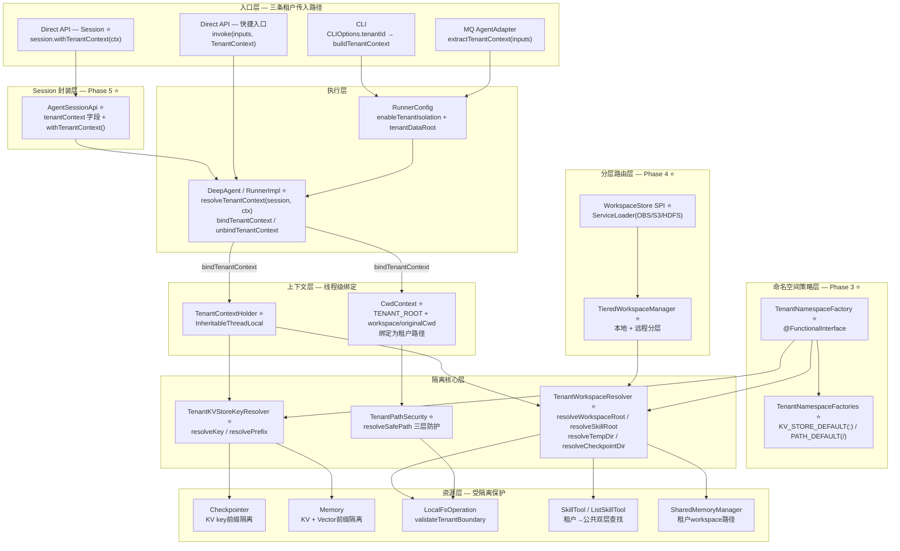
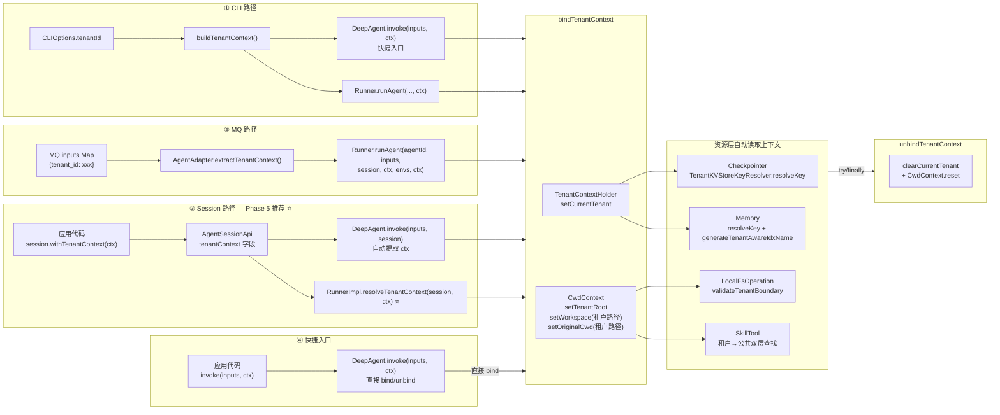

# agent-core-java 多租户数据隔离设计规格

## 〇、架构总览

### 0.1 多租户数据隔离整体架构



> ⭐ 标记的组件为多租户隔离新增的核心组件，构成隔离的"信任边界"。Phase 3 增加了 TenantNamespaceFactory 策略抽象，Phase 4 增加了 TieredWorkspaceManager 分层路由，Phase 5 将 TenantContext 封装进 AgentSessionApi，统一了 invoke/stream 的租户参数传递方式。

### 0.2 tenant_id 端到端传递链路



> **关键设计**：Phase 5 后所有入口最终汇聚到 `bindTenantContext()` → 设置 `TenantContextHolder` + 将 `CwdContext` 的 workspace/originalCwd/tenantRoot 绑定为租户路径 → 资源层组件自动从上下文读取租户信息 → 执行完毕后 `unbindTenantContext()` 清除上下文。
>
> **Phase 5 变化**：推荐通过 `AgentSessionApi.withTenantContext(ctx)` 传入租户上下文，`DeepAgent.invoke(inputs, session)` 和 `RunnerImpl` 从 session 自动提取 `tenantContext`，通过 `resolveTenantContext(session, explicitCtx)` 统一处理两种来源（session 内嵌优先，显式参数兜底）。流式方法使用 wrapper iterator（`TenantUnbindIterator`）在迭代耗尽时自动 unbind，异步方法使用 `ReactiveAdapters.fromCallable` / `deferWithSessionCleanup` 确保 finally 中 unbind。

## 一、需求概述

### 1.1 问题陈述

当前 DeepAgent 框架在超级智能体场景中采用单例模型创建实体，共享统一的 workspace/tmp 目录作为工作空间。在多租户企业客户场景下，存在数据隔离不足的问题：

1. 不同租户共享同一个实例工作空间及 tmp 临时目录，可能导致租户之间临时文件互相访问或写入干扰
2. skill 目录当前对所有请求上下文可见，无法基于租户粒度隔离
3. 从智能体入口进入智能体后台后，系统只能感知不同 session，缺少基于租户 ID 的数据隔离能力
4. 企业多租户场景下，不同租户之间可能发生数据越界访问，不满足客户合规要求

### 1.2 期望行为

1. DeepAgent 支持基于请求参数中的租户 ID（tenantId）进行数据隔离
2. 租户粒度由业务方决定，可以是个人、部门或其他业务维度；框架内不感知具体业务概念
3. 框架不负责租户合法性校验，不判断用户是否属于某个租户
4. 框架仅根据 tenantId：拉取该租户已有数据，或在数据不存在时创建新的租户数据空间
5. 需隔离的数据：租户维度的 skill 数据、租户运行过程中临时生成的文件、租户工作空间中的临时写入数据
6. 不需隔离的数据：智能体配置文件、运行日志等公共运维类数据

### 1.3 验收标准

1. 不同 tenantId 之间无法访问彼此的 skill 数据
2. 不同 tenantId 之间无法访问彼此临时生成的文件
3. 不同 tenantId 之间的临时写入不会互相影响
4. 携带已有 tenantId 时，DeepAgent 能正确加载该租户对应的数据空间
5. 携带新的 tenantId 且数据不存在时，DeepAgent 能创建新的租户数据空间
6. 不能通过路径拼接、相对路径、软链接等方式访问其他租户的数据目录
7. 框架不依赖个人、部门等业务字段即可完成租户数据隔离

---

## 二、方案决策

### 2.1 架构模式选择

经过对比分析，选择 **无状态动态隔离 + 混合渐进式实施**（方案 C）：

| 决策项 | 选择 | 理由 |
|--------|------|------|
| 隔离模式 | 无状态动态隔离（上下文透传） | 与 agent-core-java 现有 Session/ThreadLocal 体系对齐，内存占用低，水平扩展友好 |
| tenantId 传入方式 | 调用参数显式传入 | 框架不自动推断租户身份，调用方明确传入更安全可追溯 |
| Skill 隔离粒度 | 公共 + 租户双层 | 公共 skill 所有租户共享，租户私有 skill 仅自己可见；租户可覆盖同名公共 skill |
| 向后兼容策略 | 完全向后兼容 | 不传 tenantId 时行为与现有完全一致，零迁移风险 |

### 2.2 方案对比（排除方案）

| 方案 | 排除理由 |
|------|----------|
| 多实例隔离（TenantAgentManager） | 每个租户一个 DeepAgent 实例，内存占用高（O(N)），扩展受限，并发模型复杂 |
| NamespaceFactory 全量重构（方案 B） | 改动量大（~20+ 类），涉及核心层重构，TieredWorkspaceManager 需新存储 SPI，风险高 |

---

## 三、核心数据模型

### 3.1 TenantContext — 租户上下文

```java
package com.openjiuwen.core.multitenant;

import lombok.Data;
import lombok.Builder;
import java.util.Map;

@Data
@Builder
public class TenantContext {
    private final String tenantId;
    private final Map<String, String> extensions;

    public boolean isTenantAware() {
        return tenantId != null && !tenantId.isEmpty();
    }

    public String safeTenantId() {
        if (tenantId == null) return null;
        String sanitized = tenantId.replaceAll("[^a-zA-Z0-9_\\-]", "_");
        if (sanitized.isEmpty()) return null;
        return sanitized;
    }
}
```

**设计要点**：

- `tenantId` 为不透明标识符，框架不感知其业务含义（可能是个人、部门、组织或其他维度）
- `safeTenantId()` 仅做字符规范化（非安全字符替换为 `_`），不做语义推断
- `extensions` Map 留给业务方传递自定义元数据，框架内部不使用
- `isTenantAware()` 决定是否走隔离逻辑；不传 tenantId 时返回 false → 向后兼容

### 3.2 TenantContextHolder — 线程级上下文传播

```java
package com.openjiuwen.core.multitenant;

public final class TenantContextHolder {
    private static final InheritableThreadLocal<TenantContext> CURRENT_TENANT;

    public static TenantContext getCurrentTenant() { return CURRENT_TENANT.get(); }
    public static void setCurrentTenant(TenantContext ctx) { CURRENT_TENANT.set(ctx); }
    public static void clearCurrentTenant() { CURRENT_TENANT.remove(); }
}
```

**设计对齐**：与现有 `SessionContextHolder` 模式一致，使用 `InheritableThreadLocal` 使子任务/子 Agent 自动继承租户上下文。

### 3.3 TenantWorkspaceResolver — 租户目录解析与安全管理

```java
package com.openjiuwen.core.multitenant;

import java.nio.file.*;
import java.util.concurrent.*;

public class TenantWorkspaceResolver {
    private final String baseWorkspacePath;
    private final ConcurrentMap<String, Path> initializedTenants = new ConcurrentHashMap<>();

    public Path resolveWorkspaceRoot(TenantContext ctx) {
        if (!ctx.isTenantAware()) {
            return Path.of(baseWorkspacePath);
        }
        return Path.of(baseWorkspacePath, "tenants", ctx.safeTenantId(), "workspace")
                   .toAbsolutePath().normalize();
    }

    public Path resolveSkillRoot(TenantContext ctx) {
        if (!ctx.isTenantAware()) {
            return null;
        }
        return Path.of(baseWorkspacePath, "tenants", ctx.safeTenantId(), "skills")
                   .toAbsolutePath().normalize();
    }

    public Path resolveTempDir(TenantContext ctx) {
        if (!ctx.isTenantAware()) {
            return Path.of(baseWorkspacePath, "tmp");
        }
        return Path.of(baseWorkspacePath, "tenants", ctx.safeTenantId(), "tmp")
                   .toAbsolutePath().normalize();
    }

    public Path resolveCheckpointDir(TenantContext ctx) {
        if (!ctx.isTenantAware()) {
            return Path.of(baseWorkspacePath, "checkpoints");
        }
        return Path.of(baseWorkspacePath, "tenants", ctx.safeTenantId(), "checkpoints")
                   .toAbsolutePath().normalize();
    }

    public Path initializeTenantSpace(TenantContext ctx) {
        if (!ctx.isTenantAware()) return Path.of(baseWorkspacePath);
        return initializedTenants.computeIfAbsent(ctx.safeTenantId(), tid -> {
            Path root = Path.of(baseWorkspacePath, "tenants", tid);
            try {
                Files.createDirectories(root.resolve("workspace"));
                Files.createDirectories(root.resolve("skills"));
                Files.createDirectories(root.resolve("tmp"));
                Files.createDirectories(root.resolve("checkpoints"));
            } catch (IOException e) {
                throw new RuntimeException("Failed to initialize tenant space: " + tid, e);
            }
            return root;
        });
    }

    public boolean isPathWithinTenant(Path requestedPath, TenantContext ctx) {
        if (!ctx.isTenantAware()) return true;
        Path tenantRoot = Path.of(baseWorkspacePath, "tenants", ctx.safeTenantId())
                              .toAbsolutePath().normalize();
        Path normalized = requestedPath.toAbsolutePath().normalize();
        return normalized.startsWith(tenantRoot);
    }
}
```

**目录结构**：

```
baseWorkspacePath/
├── tmp/                          # 默认临时目录（无租户时使用）
├── skills/                       # 默认 skill（无租户时使用）
├── checkpoints/                  # 默认检查点（无租户时使用）
├── tenants/
│   ├── {tenantId_1}/             # 租户1（tenantId 由业务方定义）
│   │   ├── skills/
│   │   ├── tmp/
│   │   └── checkpoints/
│   ├── {tenantId_2}/             # 租户2
│   │   ├── skills/
│   │   ├── tmp/
│   │   └── checkpoints/
│   ...
```

**并发安全**：`ConcurrentHashMap.computeIfAbsent` 确保多线程同时初始化同一租户时只执行一次目录创建。

### 3.4 TenantPathSecurity — 路径安全校验

```java
package com.openjiuwen.core.multitenant;

import java.nio.file.*;

public class TenantPathSecurity {

    public static Path resolveSafePath(String relativePath, String tenantRoot) {
        Path cwd = Path.of(System.getProperty("user.dir"));
        Path resolved = cwd.resolve(relativePath).toAbsolutePath().normalize();

        if (tenantRoot != null) {
            Path root = Path.of(tenantRoot).toAbsolutePath().normalize();
            if (!resolved.startsWith(root)) {
                throw new SecurityException(
                    "Path traversal blocked: " + relativePath +
                    " is outside tenant boundary");
            }
        }

        try {
            if (Files.exists(resolved) && Files.isSymbolicLink(resolved)) {
                Path realTarget = resolved.toRealPath();
                if (tenantRoot != null) {
                    Path root = Path.of(tenantRoot).toAbsolutePath().normalize();
                    if (!realTarget.startsWith(root)) {
                        throw new SecurityException(
                            "Symlink traversal blocked: symlink target is outside tenant boundary");
                    }
                }
            }
        } catch (IOException e) {
            throw new SecurityException("Failed to resolve symlink: " + relativePath, e);
        }

        return resolved;
    }
}
```

**安全防护链**：

1. `safeTenantId()` 规范化 → 阻止非安全字符注入
2. `toAbsolutePath().normalize()` + `startsWith` 校验 → 阻止 `../` 路径穿越
3. `toRealPath()` 软链接解析 + 二次校验 → 阻止软链接穿越
4. `TENANT_ROOT` InheritableThreadLocal 约束 → 同线程内所有文件操作统一边界

---

## 四、组件改造方案

### 4.1 DeepAgent 入口改造

**改造文件**：`com.openjiuwen.harness.deep_agent.DeepAgent`

**最终方法签名（Phase 5 简化后）**：

```java
// 无租户 — 原有签名不变
public Map<String, Object> invoke(Map<String, Object> inputs)
public Map<String, Object> invoke(Map<String, Object> inputs, AgentSessionApi session)

// 快捷入口 — 显式传入 TenantContext（适合无 session 场景）
public Map<String, Object> invoke(Map<String, Object> inputs, TenantContext tenantCtx)

// stream 同理
public Iterator<Object> stream(Map<String, Object> inputs)
public Iterator<Object> stream(Map<String, Object> inputs, List<StreamMode> streamModes)
public Iterator<Object> stream(Map<String, Object> inputs, TenantContext tenantCtx)
public Iterator<Object> stream(Map<String, Object> inputs, List<StreamMode> streamModes, TenantContext tenantCtx)
public Iterator<Object> stream(Map<String, Object> inputs, AgentSessionApi session, List<StreamMode> streamModes)
```

**关键设计**（Phase 5 后）：
- `invoke(inputs, session)` 从 session 自动提取 `tenantContext`：`session.getTenantContext()`
- `invoke(inputs, TenantContext)` 作为快捷入口，直接 bind/unbind
- 已删除的组合重载：`invoke(inputs, session, TenantContext)` 和 `stream(inputs, session, streamModes, TenantContext)`
- session 内嵌方式优先（推荐），快捷入口为无 session 场景提供便利

**租户绑定逻辑**：

```java
public Map<String, Object> invoke(Map<String, Object> inputs, AgentSessionApi session) {
    TenantContext ctx = (session != null) ? session.getTenantContext() : null;
    if (ctx != null && ctx.isTenantAware()) {
        TenantContextHolder.setCurrentTenant(ctx);
        try {
            bindTenantWorkspace(ctx);
            return invokeInternal(inputs, session);
        } finally {
            TenantContextHolder.clearCurrentTenant();
            unbindTenantWorkspace();
        }
    }
    return invokeInternal(inputs, session);
}

public Map<String, Object> invoke(Map<String, Object> inputs, TenantContext tenantCtx) {
    TenantContextHolder.setCurrentTenant(tenantCtx);
    try {
        bindTenantWorkspace(tenantCtx);
        return invoke(inputs);
    } finally {
        TenantContextHolder.clearCurrentTenant();
        unbindTenantWorkspace();
    }
}

private void bindTenantWorkspace(TenantContext ctx) {
    if (ctx != null && ctx.isTenantAware()) {
        if (tieredWorkspaceManager != null) {
            tieredWorkspaceManager.initializeTenantSpace(ctx);
            WorkspaceResolution workspaceRes = tieredWorkspaceManager.resolve(ctx, WorkspaceType.WORKSPACE);
            Path tenantWorkspace = workspaceRes.getLocalPath();
            CwdContext.setWorkspace(tenantWorkspace.toString());
            CwdContext.setOriginalCwd(tenantWorkspace.toString());
            CwdContext.setTenantRoot(tenantWorkspace.getParent().toString());
            workspaceResolver = new TenantWorkspaceResolver(
                config.getTenantDataRoot() != null ? config.getTenantDataRoot() : config.getWorkspacePath(),
                tieredWorkspaceManager.getNamespaceFactory());
        } else {
            String baseWorkspace = config.getTenantDataRoot() != null ? config.getTenantDataRoot() : config.getWorkspacePath();
            workspaceResolver = new TenantWorkspaceResolver(baseWorkspace);
            Path tenantWorkspace = workspaceResolver.resolveWorkspaceRoot(ctx);
            workspaceResolver.initializeTenantSpace(ctx);
            CwdContext.setWorkspace(tenantWorkspace.toString());
            CwdContext.setOriginalCwd(tenantWorkspace.toString());
            CwdContext.setTenantRoot(workspaceResolver.resolveWorkspaceRoot(ctx).getParent().toString());
        }
    }
}

private void unbindTenantWorkspace() {
    CwdContext.reset();
}
```

**关键设计**：
- session 内嵌方式自动提取 tenantContext，无需额外参数 → 消除方法重载爆炸
- `bindTenantWorkspace()` 支持 TieredWorkspaceManager 和普通 TenantWorkspaceResolver 两种模式
- CwdContext 绑定 `workspace`、`originalCwd`、`tenantRoot` 三个字段为租户路径
- `try-finally` 确保清理，防止租户上下文泄漏
- 流式方法的 unbind 通过 wrapper iterator 或 `TenantUnbindIterator` 在迭代耗尽时自动触发

### 4.2 CwdContext 改造

**改造文件**：`com.openjiuwen.core.sysop.cwd.CwdContext`

**新增**：

```java
private static final InheritableThreadLocal<String> TENANT_ROOT;

public static String getTenantRoot() { return TENANT_ROOT.get(); }
public static void setTenantRoot(String tenantRoot) { TENANT_ROOT.set(tenantRoot); }

public static boolean isWithinTenantRoot(Path path) {
    String root = getTenantRoot();
    if (root == null) return true;
    Path normalized = path.toAbsolutePath().normalize();
    Path rootPath = Path.of(root).toAbsolutePath().normalize();
    return normalized.startsWith(rootPath);
}
```

**向后兼容**：`TENANT_ROOT` 为 null 时 `isWithinTenantRoot()` 返回 true → 允许所有路径访问，行为与现有一致。

### 4.3 LocalFsOperation 改造

**改造文件**：`com.openjiuwen.core.sysop.local.LocalFsOperation`

**新增**：

```java
protected Path validateTenantBoundary(Path requestedPath) {
    String tenantRoot = CwdContext.getTenantRoot();
    if (tenantRoot == null) return requestedPath;
    Path normalized = requestedPath.toAbsolutePath().normalize();
    Path rootPath = Path.of(tenantRoot).toAbsolutePath().normalize();
    if (!normalized.startsWith(rootPath)) {
        throw new SecurityException(
            "Tenant boundary violation: path '" + normalized +
            "' is outside tenant root '" + rootPath + "'");
    }
    return requestedPath;
}
```

所有文件操作方法（readFile/writeFile/readFileStream/uploadFile/uploadFileStream/downloadFile/downloadFileStream/listFiles/listDirectories/searchFiles）在执行前调用 `validateTenantBoundary()` 校验路径边界。

### 4.4 SkillTool / ListSkillTool 改造

**改造文件**：`com.openjiuwen.harness.tools.SkillTool`、`ListSkillTool`

**SkillTool 双层查找逻辑**：

> **注意**：SkillTool 的 `publicSkillsRoot` 在初始化时从 `DeepAgentConfig.skillDirectories`（公共 skill 源路径）获取。无租户时仅使用该路径作为 skill 根目录，行为与现有完全一致。

```java
public ToolOutput readSkill(String skillName, String relativeFilePath) {
    TenantContext ctx = TenantContextHolder.getCurrentTenant();

    if (ctx != null && ctx.isTenantAware()) {
        Path tenantSkillRoot = workspaceResolver.resolveSkillRoot(ctx);
        Path tenantSkillFile = tenantSkillRoot.resolve(skillName)
            .resolve(relativeFilePath != null ? relativeFilePath : "SKILL.md");
        if (Files.exists(tenantSkillFile)) {
            return ToolOutput.success(Map.of(
                "skill_directory", tenantSkillRoot.resolve(skillName).toString(),
                "skill_content", Files.readString(tenantSkillFile),
                "source", "tenant"
            ));
        }
    }

    Path publicSkillFile = publicSkillsRoot.resolve(skillName)
        .resolve(relativeFilePath != null ? relativeFilePath : "SKILL.md");
    if (Files.exists(publicSkillFile)) {
        return ToolOutput.success(Map.of(
            "skill_directory", publicSkillsRoot.resolve(skillName).toString(),
            "skill_content", Files.readString(publicSkillFile),
            "source", "public"
        ));
    }

    return ToolOutput.error("Skill not found: " + skillName);
}
```

**Skill 查找优先级**：租户私有 skill → 公共 skill → Skill not found

- 租户可覆盖同名公共 skill（同名 skill 私有优先）
- 公共 skill 对所有租户可见
- 无租户时只查找公共 skill（向后兼容）

**ListSkillTool 双层列表逻辑**：

```java
public ToolOutput listSkills() {
    List<String> allSkills = new ArrayList<>();
    TenantContext ctx = TenantContextHolder.getCurrentTenant();

    Files.list(publicSkillsRoot)
         .filter(Files::isDirectory)
         .map(p -> p.getFileName().toString())
         .forEach(allSkills::add);

    if (ctx != null && ctx.isTenantAware()) {
        Path tenantSkillRoot = workspaceResolver.resolveSkillRoot(ctx);
        if (Files.exists(tenantSkillRoot)) {
            Files.list(tenantSkillRoot)
                 .filter(Files::isDirectory)
                 .map(p -> p.getFileName().toString())
                 .forEach(allSkills::add);
        }
    }

    return ToolOutput.success(Map.of("skills", allSkills));
}
```

### 4.5 需隔离数据全景分析

经过对 agent-core-java 项目所有存储组件的系统性梳理，需隔离的数据范围远不止原始需求中列出的 3 类。以下是完整的数据隔离清单：

#### 需要隔离的数据（租户维度）

| 序号 | 数据类别 | 存储组件 | 数据内容 | 隔离维度 | 生命周期 |
|------|---------|---------|---------|---------|---------|
| 1 | Skill 数据 | SkillTool/ListSkillTool | 租户私有 skill 定义与内容 | tenantId | 跨进程持久化 |
| 2 | 临时文件 | TenantWorkspaceResolver | tmp 目录下运行时临时生成文件 | tenantId | 会话级/进程级 |
| 3 | Workspace 临时写入 | SysOperation (FsOperation) | workspace 下的文件读写 | tenantId | 跨进程持久化 |
| 4 | Checkpointer Agent 状态 | InMemoryCheckpointer / PersistenceCheckpointer / RedisCheckpointer | Agent 状态快照 (global_state + agent_state) | tenantId + sessionId | Session 级/跨进程持久化 |
| 5 | Checkpointer Workflow 状态 | 同上 | Workflow 状态快照 (5 分区 + pending updates) | tenantId + sessionId | Session 级/跨进程持久化 |
| 6 | Checkpointer Graph Store | InMemoryStore / PersistenceGraphStore / RedisGraphStore | GraphStoreState (channelValues, pendingBuffer, pendingNode, nodeVersion) | tenantId + sessionId | Session 级/跨进程持久化 |
| 7 | Memory ScopeConfig | LongTermMemory (KVStore) | Memory scope 配置 (model_cfg, embedding_cfg, api_key) | tenantId + scopeId | 跨进程持久化 |
| 8 | Memory 用户记忆 | LongTermMemory (UserMemStore / KVStore) | 用户记忆数据 (profile, semantic, episodic, summary) | tenantId + userId + scopeId | 跨进程持久化 |
| 9 | Memory 用户/会话变量 | LongTermMemory (VariableManager / KVStore) | 用户/会话变量 (可加密) | tenantId + userId/sessionId + scopeId | 跨进程持久化 |
| 10 | Memory 消息记录 | LongTermMemory (MessageManager / BaseDbStore) | 会话消息记录 (role, content, timestamp) | tenantId + userId + scopeId | 跨进程持久化 |
| 11 | Memory 向量存储 | LongTermMemory (VectorStore) | 语义记忆向量嵌入 + 元数据 | tenantId + scopeId/userId | 跨进程持久化 |
| 12 | Memory 团队共享 | SharedMemoryManager | TEAM_MEMORY.md 团队共享记忆文件 | tenantId + workspace | 跨进程持久化 |
| 13 | Memory 个人索引 | MemoryIndexManager | 记忆索引文件 + MEMORY.md 个人记忆 | tenantId + workspace | 跨进程持久化 |
| 14 | Session.State 全分区 | AgentStateCollection / WorkflowCommitState | global/agent/io/comp/workflow/trace 6 个状态分区 | tenantId + sessionId | Session 级 |
| 15 | KVStore 业务数据 | BaseKVStore 各实现 | 除分布式锁和 migration 版本外的所有业务数据 | tenantId + 业务维度 | 跨进程持久化 |

#### 不需要隔离的数据（公共共享）

| 数据类别 | 存储组件 | 说明 |
|---------|---------|------|
| 智能体配置文件 | DeepAgentConfig | 全局配置，所有租户共享 |
| 运行日志 | Loggers | 公共运维数据 |
| ResourceMgr 资源池 | RunnerImpl | 全局共享资源注册表 |
| MessageQueue | LocalMessageQueue / DistributedMQ | 全局通信基础设施 |
| CallbackFramework | CallbackFramework | 全局回调框架 |
| 分布式锁 | DistributedLock (KVStore) | 临时锁（10s TTL），不存储业务数据 |
| Migration 版本标记 | KvMigrator | 全局迁移标记 |

### 4.6 Checkpointer 全链路改造

**改造目标**：所有 Checkpointer 实现的 key 生成逻辑增加 tenantId 前缀。

#### 4.6.1 Checkpointer 基类

**改造文件**：`com.openjiuwen.core.session.checkpointer.Checkpointer`

**新增方法**（原有 buildKey/buildKeyWithNamespace 不变）：

```java
public static String buildKeyWithTenant(TenantContext ctx, String... parts) {
    if (ctx != null && ctx.isTenantAware()) {
        String[] allParts = new String[parts.length + 1];
        allParts[0] = ctx.safeTenantId();
        System.arraycopy(parts, 0, allParts, 1, parts.length);
        return buildKey(allParts);
    }
    return buildKey(parts);
}
```

#### 4.6.2 InMemoryCheckpointer

**改造文件**：`com.openjiuwen.core.session.checkpointer.InMemoryCheckpointer`

**改造方式**：所有 `agentStores`、`workflowStores`、`sessionToWorkflowIds` 的 key 从 `sessionId` 变为 `tenantId:sessionId`。

```java
private String tenantAwareSessionId(String sessionId) {
    TenantContext ctx = TenantContextHolder.getCurrentTenant();
    if (ctx != null && ctx.isTenantAware()) {
        return ctx.safeTenantId() + ":" + sessionId;
    }
    return sessionId;
}
```

- `agentStores.get(tenantAwareSessionId(sessionId))` 替代原有 `agentStores.get(sessionId)`
- `workflowStores.get(tenantAwareSessionId(sessionId))` 同理
- `release()` 中 `agentStores.remove(tenantAwareSessionId(sessionId))` 同理
- InMemoryStore 的 graphStore key 同样使用 `tenantAwareSessionId`

#### 4.6.3 PersistenceCheckpointer

**改造文件**：`com.openjiuwen.core.session.checkpointer.PersistenceCheckpointer`

**改造方式**：PersistenceAgentStorage 和 PersistenceWorkflowStorage 的所有 key 生成调用 `buildKeyWithTenant()` 替代原有 key 生成。

```java
private String buildTenantAwareKey(String sessionId, String namespace, String entityId, String suffix) {
    TenantContext ctx = TenantContextHolder.getCurrentTenant();
    return Checkpointer.buildKeyWithTenant(ctx,
        sessionId, namespace, entityId, suffix);
}
```

- 所有 `kvStore.set(key, ...)` 的 key 使用 `buildTenantAwareKey()` 生成
- `release()` 中 `kvStore.deleteByPrefix(tenantAwareSessionId(sessionId) + ":")` 替代原有 `sessionId + ":"`

#### 4.6.4 RedisCheckpointer

**改造文件**：`com.openjiuwen.extensions.checkpointer.redis.RedisCheckpointer`

**改造方式**：同 PersistenceCheckpointer，所有 Redis key 生成调用 `buildKeyWithTenant()`。

- Redis key 前缀从 `deepagent:sessionId:...` 变为 `deepagent:tenantId:sessionId:...`
- `deleteByPrefix()` 可按租户批量清理：`deepagent:tenantId:*`

#### 4.6.5 Key 格式变更对比

| 场景 | 无租户（现有格式） | 有租户 `abc123` |
|------|-------------------|----------------|
| Agent 状态 | `session-1:agent:react_agent:state_blobs` | `abc123:session-1:agent:react_agent:state_blobs` |
| Workflow 状态 | `session-1:workflow:wf-1:state_blobs` | `abc123:session-1:workflow:wf-1:state_blobs` |
| Graph Store | `session-1:workflow-graph:ns:checkpoint_data_type` | `abc123:session-1:workflow-graph:ns:checkpoint_data_type` |
| 批量清理 | `deleteByPrefix("session-1:")` | `deleteByPrefix("abc123:")` |

### 4.7 LongTermMemory 改造

**改造目标**：Memory 的所有持久化数据增加 tenantId 前缀。

#### 4.7.1 KVStore Key 改造

**涉及文件**：`com.openjiuwen.core.memory.LongTermMemory`

**改造方式**：所有 KVStore key 生成增加 tenantId 前缀。

```java
private String tenantAwareKey(String originalKey) {
    TenantContext ctx = TenantContextHolder.getCurrentTenant();
    if (ctx != null && ctx.isTenantAware()) {
        return ctx.safeTenantId() + "/" + originalKey;
    }
    return originalKey;
}
```

**Key 格式变更对比**：

| 数据 | 无租户 | 有租户 `abc123` |
|------|--------|----------------|
| ScopeConfig | `memory_scope_config/scopeId` | `abc123/memory_scope_config/scopeId` |
| 用户记忆 | `UMD/userId/scopeId/memId` | `abc123/UMD/userId/scopeId/memId` |
| 用户变量 | `user_var/userId/scopeId/varName` | `abc123/user_var/userId/scopeId/varName` |
| 会话变量 | `session_var/sessionId/varName` | `abc123/session_var/sessionId/varName` |

#### 4.7.2 VectorStore 改造

**改造方式**：向量索引名称增加 tenantId 前缀。

```java
private String tenantAwareCollectionName(String originalName) {
    TenantContext ctx = TenantContextHolder.getCurrentTenant();
    if (ctx != null && ctx.isTenantAware()) {
        return ctx.safeTenantId() + "_" + originalName;
    }
    return originalName;
}
```

- Milvus collection: `user_memory` → `abc123_user_memory`
- 无租户时 collection 名称不变

#### 4.7.3 BaseDbStore (MessageManager / ScopeUserMappingManager) 改造

**改造方式**：SQL 表增加 `tenant_id` 列，所有查询增加 tenantId WHERE 条件。

```sql
-- 原有表结构增加 tenant_id 列
ALTER TABLE messages ADD COLUMN tenant_id VARCHAR(128);
ALTER TABLE scope_user_mapping ADD COLUMN tenant_id VARCHAR(128);

-- 查询时自动添加 tenant_id 条件
SELECT * FROM messages WHERE tenant_id = ? AND user_id = ? AND scope_id = ?
```

- 无租户时 `tenant_id` 为空字符串（`""`），查询条件变为 `tenant_id = ''`
- 向后兼容：无租户场景下 tenant_id 列为空，不影响现有数据

### 4.8 Memory 团队/个人数据改造

**改造目标**：SharedMemoryManager 和 MemoryIndexManager 的文件路径增加租户隔离。

#### 4.8.1 SharedMemoryManager

**涉及文件**：`com.openjiuwen.core.memory.team.SharedMemoryManager`

**改造方式**：`teamMemoryDir` 路径从 workspace 下改为租户 workspace 下。

```java
private String resolveTeamMemoryDir() {
    TenantContext ctx = TenantContextHolder.getCurrentTenant();
    if (ctx != null && ctx.isTenantAware()) {
        Path tenantWorkspace = TenantWorkspaceResolver.resolveWorkspaceRoot(ctx);
        return tenantWorkspace.resolve("team_memory").toString();
    }
    return originalTeamMemoryDir;  // 向后兼容
}
```

#### 4.8.2 MemoryIndexManager

**涉及文件**：`com.openjiuwen.core.memory.team.MemoryIndexManager`

**改造方式**：个人记忆索引文件路径跟随 CwdContext 的 workspace（已被 DeepAgent.bindTenantWorkspace() 绑定为租户 workspace）。

- CwdContext.getWorkspace() 已在 DeepAgent 入口绑定为租户路径
- MemoryIndexManager 使用 `workspace.getNodePath("memory")` 获取路径
- 路径自动跟随租户隔离，无需额外改造

### 4.9 Session.State 改造

**改造目标**：Session.State 的所有分区数据通过 Checkpointer 和 CwdContext 间接实现租户隔离。

**分析**：Session.State 的 6 个分区（global/agent/io/comp/workflow/trace）是内存数据，通过 Checkpointer 持久化。改造方式：

1. **内存层面**：State 数据以 sessionId 为 key 存储，而 sessionId 在 Checkpointer 中已增加 tenantId 前缀，因此内存数据间接隔离
2. **持久化层面**：Checkpointer 已改造 key 格式，持久化的 State 数据自动隔离
3. **不需要额外改造**：State 的读写操作本身不涉及跨租户访问

### 4.10 KVStore 通用改造

**改造目标**：提供一个通用的 tenantId key 前缀工具方法。

**新增文件**：`com.openjiuwen.core.multitenant.TenantKVStoreKeyResolver`

```java
package com.openjiuwen.core.multitenant;

public class TenantKVStoreKeyResolver {
    public static String resolveKey(String originalKey) {
        TenantContext ctx = TenantContextHolder.getCurrentTenant();
        if (ctx != null && ctx.isTenantAware()) {
            return ctx.safeTenantId() + ":" + originalKey;
        }
        return originalKey;
    }

    public static String resolvePrefix(String originalPrefix) {
        TenantContext ctx = TenantContextHolder.getCurrentTenant();
        if (ctx != null && ctx.isTenantAware()) {
            return ctx.safeTenantId() + ":" + originalPrefix;
        }
        return originalPrefix;
    }
}
```

**使用方式**：所有业务数据写入 KVStore 时，key 通过 `TenantKVStoreKeyResolver.resolveKey()` 生成。

### 4.11 DeepAgentConfig 改造

**改造文件**：`com.openjiuwen.harness.schema.config.DeepAgentConfig`

**新增字段**：

```java
private boolean enableTenantIsolation = false;
private String tenantDataRoot;
```

- `enableTenantIsolation` 默认 false → 关闭时不走隔离逻辑，完全向后兼容
- `tenantDataRoot` 指定租户数据根目录；为空时默认在 `workspacePath` 下的 `tenants/`

---

## 五、测试策略

### 5.1 单元测试（UT）

| 测试类 | 测试数 | 覆盖范围 | 对应验收标准 |
|--------|--------|----------|-------------|
| TenantContextTest | 8 | safeTenantId 规范化、isTenantAware 判断、extensions | 7 |
| TenantContextHolderTest | 5 | ThreadLocal set/get/clear、子线程继承（InheritableThreadLocal） | 7 |
| TenantWorkspaceResolverTest | 11 | resolveWorkspaceRoot/resolveSkillRoot/resolveTempDir/resolveCheckpointDir、initializeTenantSpace 并发安全、isPathWithinTenant | 4, 5 |
| TenantPathSecurityTest | 4 pass + 2 skip | 路径穿越防御（`../` 穿越、绝对路径穿越）、软链接穿越（Windows skip）、tenantId 注入防护 | 6 |
| TenantKVStoreKeyResolverTest | 5 | resolveKey/resolvePrefix、NamespaceFactory 集成 | — |
| TenantNamespaceFactoryTest | 7 | KV_STORE_DEFAULT(`:`分隔符)、PATH_DEFAULT(`/`分隔符)、自定义 factory、TenantWorkspaceResolver 集成 | — |
| TenantBackwardCompatTest | 11 | 不传 TenantContext 时行为完全一致、null/empty tenantId 处理 | 向后兼容 |
| TenantSkillIsolationTest | 10 | 租户私有 skill 互不可见、租户覆盖公共 skill、公共 skill 共享 | 1 |
| TenantTempFileIsolationTest | 5 | 租户临时文件互不可见、临时写入互不影响 | 2, 3 |
| TenantCheckpointerIsolationTest | 5 | InMemory/Persistence/Redis 三个 Checkpointer tenantId 前缀隔离、无租户 key 格式、按租户批量清理 | 4 |
| TenantMemoryIsolationTest | 15 | Memory KV key 前缀隔离、ScopeConfig 隔离、用户变量隔离 | — |
| TenantSharedMemoryTest | 9 | SharedMemoryManager 租户路径隔离 | — |
| TenantConcurrencyTest | 4 | 多线程并发初始化同一租户空间（ConcurrentHashMap.computeIfAbsent）、不同租户并发不串数据 | 5 |
| CwdContextTenantTest | 4 | TENANT_ROOT set/get、isWithinTenantRoot、reset 清除 | — |
| FsOperationTenantTest | 13 | readFile/writeFile/readFileStream/uploadFile/uploadFileStream/downloadFile/downloadFileStream/listFiles/listDirectories/searchFiles 所有方法 validateTenantBoundary | 3 |
| DeepAgentTenantTest | 14 | invoke/stream 带 TenantContext/session 两种传参方式、bind/unbind 清理验证 | 1-7 |
| AgentSessionApiTenantTest | 6 | tenantContext 字段、withTenantContext() 链式方法、AgentGroupSessionApi 继承、create 工厂方法 | — |
| RunnerImplTenantTest | 12 | resolveTenantContext(session, ctx) 统一提取、bind/unbind、流式 TenantUnbindIterator、异步 fromCallable/deferWithSessionCleanup | — |
| RunnerTenantBackwardCompatTest | 6 | Runner 无 TenantContext 重载行为一致 | 向后兼容 |
| RunnerTenantProxyTest | 3 | Runner 静态代理方法正确传播 TenantContext | — |
| AgentAdapterTenantTest | 4 | AgentAdapter.extractTenantContext 从 inputs Map 提取、handleInvoke/handleStream 传播和清理 | — |
| HarnessCliTenantTest | 6 | CLIOptions.tenantId 构建、buildTenantContext 边界处理 | — |
| RunnerConfigTest（TenantIsolationConfig 嵌套） | 7 | enableTenantIsolation + tenantDataRoot 配置 | — |
| TieredWorkspaceManagerTest | 11 | resolve 各类型（本地+远程）、initializeTenantSpace、自定义 namespaceFactory | — |
| WorkspaceStoreTest | 14 | LocalWorkspaceStore、SPI Provider 注册与发现 | — |

**总计**：~193 个 UT 测试，0 failures, 0 errors

### 5.2 安全专项测试

**路径穿越防御（TenantPathSecurityTest + FsOperationTenantTest 覆盖）**：

- `../` 穿越：请求 `../../etc/passwd` 等路径被 `normalize() + startsWith()` 阻止
- 绝对路径穿越：请求 `/etc/passwd` 被绝对路径规范化阻止
- 软链接穿越：在租户 workspace 内创建指向 `/etc` 的软链接，`toRealPath()` 二次校验阻止（Windows 上 symlink 创建受限，2 个测试 skip）
- tenantId 特殊字符注入：`abc../../123` 通过 `safeTenantId()` 规范化为 `abc______123`
- null/empty tenantId 处理：TenantContext 不传或 tenantId 为空时 `isTenantAware()` 返回 false，走非隔离逻辑

**KV key 隔离防御（TenantKVStoreKeyResolverTest + TenantCheckpointerIsolationTest 覆盖）**：

- 不同 tenantId 的 KV key 前缀不同，物理隔离
- 无 tenantId 时 key 不变，向后兼容
- `resolvePrefix("abc:")` 用于按租户批量清理

### 5.3 并发安全测试

**TenantConcurrencyTest 覆盖**：

- 多线程并发调用 `TenantWorkspaceResolver.initializeTenantSpace()` 同一 tenantId → `ConcurrentHashMap.computeIfAbsent` 保证只初始化一次
- 不同 tenantId 并发执行 → ThreadLocal 互不干扰，数据不串

### 5.4 系统测试（ST）

**TenantIsolationSystemTest**（5 个端到端 ST，使用真实 LLM）：

| 测试方法 | LLM 交互 | 验证内容 |
|----------|----------|----------|
| testInvoke_tenantWorkspaceIsolation | TENANT_A_ACK + TENANT_B_ACK | 两个租户 invoke 验证 workspace 路径隔离 |
| testInvoke_noTenant_backwardCompat | NO_TENANT_ACK | 无租户 invoke 向后兼容 |
| testStream_tenantIsolation | STREAM_ACK | stream + session.withTenantContext() 验证 |
| testInvoke_explicitTenantCtx_vs_sessionTenantCtx | EXPLICIT_ACK + SESSION_ACK | 两种传参方式（快捷入口 vs session 内嵌）对比 |
| testMemory_tenantKVStoreIsolation | 无 LLM | KV key 前缀隔离验证 |

**ST 配置与运行**：

- LLM 信息通过 `ApiConfigLoader` 从 classpath 资源 `APIKEY/apiconfig.json` 加载（不硬编码）
- git 中存储占位符值，本地开发时手动替换为真实值
- 缺少配置时 `assumeRemoteModelAvailable()` 自动跳过（JUnit 5 Assumptions）
- 运行命令：`mvn test "-Dtest=TenantIsolationSystemTest" "-Dsurefire.groups=system-test" "-Dsurefire.excludedGroups="`

### 5.5 验收标准与测试覆盖映射

| 验收标准 | 实现方式 | 覆盖测试 |
|----------|----------|----------|
| 1. 不同租户之间无法访问彼此 skill 数据 | SkillTool 双层查找 + TenantWorkspaceResolver 路径隔离 | TenantSkillIsolationTest(10) |
| 2. 不同租户之间无法访问彼此临时文件 | TenantWorkspaceResolver 独立 tmp 目录 + CwdContext TENANT_ROOT 约束 | TenantTempFileIsolationTest(5) |
| 3. 不同租户之间临时写入互不影响 | resolveSafePath() + validateTenantBoundary() 路径穿越防护 + 独立 workspace | FsOperationTenantTest(13) + TenantPathSecurityTest |
| 4. 已有 tenantId → 正确加载租户数据 | TenantWorkspaceResolver.resolveWorkspaceRoot() + initializeTenantSpace() | TenantWorkspaceResolverTest(11) + ST |
| 5. 新 tenantId → 创建新租户数据空间 | initializeTenantSpace() + ConcurrentHashMap.computeIfAbsent 并发安全 | TenantWorkspaceResolverTest + TenantConcurrencyTest |
| 6. 路径拼接/相对路径/软链接防护 | TenantPathSecurity 三层防护（规范化+startsWith+toRealPath） | TenantPathSecurityTest + FsOperationTenantTest |
| 7. 不依赖业务字段 | TenantContext 仅含 tenantId + extensions（框架不使用 extensions） | TenantContextTest(8) + TenantBackwardCompatTest(11) |
| *扩展* Checkpointer 租户隔离 | 三个 Checkpointer 实现 key 增加 tenantId 前缀 | TenantCheckpointerIsolationTest(5) |
| *扩展* Memory 租户隔离 | LongTermMemory KVStore/VectorStore 增加 tenantId | TenantMemoryIsolationTest(15) + TenantSharedMemoryTest(9) |
| *扩展* Session 内嵌 tenantContext | AgentSessionApi.withTenantContext() 链式方法 | AgentSessionApiTenantTest(6) + DeepAgentTenantTest |
| *扩展* Runner 统一提取 | resolveTenantContext(session, explicitCtx) | RunnerImplTenantTest(12) + ST |

---

## 六、新增/改造文件清单

### 新增文件（Phase 1 — 5个核心类）

```
src/main/java/com/openjiuwen/core/multitenant/
├── TenantContext.java
├── TenantContextHolder.java
├── TenantWorkspaceResolver.java
├── TenantPathSecurity.java
└── TenantKVStoreKeyResolver.java
```

### 新增文件（Phase 3 — 命名空间策略抽象）

```
src/main/java/com/openjiuwen/core/multitenant/
├── TenantNamespaceFactory.java       (@FunctionalInterface)
└── TenantNamespaceFactories.java     (KV_STORE_DEFAULT + PATH_DEFAULT 预设)
```

### 新增文件（Phase 4 — 分层路由 SPI）

```
src/main/java/com/openjiuwen/core/multitenant/workspace/
├── WorkspaceType.java               (枚举：WORKSPACE/SKILLS/TMP/CHECKPOINTS/TEAM_MEMORY)
├── WorkspaceResolution.java         (localPath + remotePaths)
├── WorkspaceStore.java              (SPI 接口)
├── WorkspaceStoreProvider.java      (SPI Provider 接口)
├── WorkspaceStoreFactory.java       (工厂 + 注册表)
├── TieredWorkspaceManager.java      (分层路由管理器)
└── store/
    ├── LocalWorkspaceStore.java
    ├── LocalWorkspaceStoreProvider.java
    ├── ObjectStorageWorkspaceStore.java
    ├── ObsWorkspaceStoreProvider.java
    ├── S3WorkspaceStoreProvider.java
    └── HdfsWorkspaceStoreProvider.java
```

### 改造文件（Phase 1 + Phase 2 + Phase 5）

```
src/main/java/com/openjiuwen/harness/deep_agent/DeepAgent.java       (Phase 1+5: session提取 + 快捷入口 + bind/unbind + TieredWorkspaceManager)
src/main/java/com/openjiuwen/core/session/AgentSessionApi.java        (Phase 5: tenantContext字段 + withTenantContext())
src/main/java/com/openjiuwen/core/session/AgentGroupSessionApi.java   (Phase 5: 继承tenantContext)
src/main/java/com/openjiuwen/core/sysop/cwd/CwdContext.java           (Phase 1: TENANT_ROOT + workspace绑定为租户路径)
src/main/java/com/openjiuwen/core/sysop/local/LocalFsOperation.java   (Phase 1: validateTenantBoundary)
src/main/java/com/openjiuwen/harness/tools/SkillTool.java             (Phase 1: 双层查找)
src/main/java/com/openjiuwen/harness/tools/ListSkillTool.java         (Phase 1: 双层列表)
src/main/java/com/openjiuwen/core/session/checkpointer/Checkpointer.java       (Phase 1: buildKeyWithTenant)
src/main/java/com/openjiuwen/core/session/checkpointer/InMemoryCheckpointer.java   (Phase 1: tenantAwareSessionId)
src/main/java/com/openjiuwen/core/session/checkpointer/PersistenceCheckpointer.java (Phase 1: TenantKVStoreKeyResolver)
src/main/java/com/openjiuwen/extensions/checkpointer/redis/RedisCheckpointer.java  (Phase 1: 4文件)
src/main/java/com/openjiuwen/core/memory/LongTermMemory.java          (Phase 1: KVStore key前缀)
src/main/java/com/openjiuwen/core/memory/common/MemoryUtils.java      (Phase 1: generateTenantAwareIdxName)
src/main/java/com/openjiuwen/core/memory/team/SharedMemoryManager.java (Phase 1: tenantAwareTeamMemoryDir)
src/main/java/com/openjiuwen/core/memory/manage/mem_model/UserMemStore.java (Phase 1: getConcatenationKey包裹)
src/main/java/com/openjiuwen/core/memory/manage/index/VariableManager.java (Phase 1: variableKey包裹)
src/main/java/com/openjiuwen/core/memory/common/DistributedLock.java  (Phase 1: lockKey包裹)
src/main/java/com/openjiuwen/harness/schema/config/DeepAgentConfig.java (Phase 1: enableTenantIsolation + tenantDataRoot + workspaceSecondaryTiers + workspaceTierConfigs)
src/main/java/com/openjiuwen/core/runner/RunnerConfig.java            (Phase 2: enableTenantIsolation + tenantDataRoot)
src/main/java/com/openjiuwen/core/runner/RunnerImpl.java              (Phase 2+5: resolveTenantContext + bind/unbind + TenantUnbindIterator + 异步cleanup)
src/main/java/com/openjiuwen/core/runner/Runner.java                  (Phase 2: 8个TenantContext静态代理)
src/main/java/com/openjiuwen/core/runner/drunner/server_adapter/AgentAdapter.java (Phase 2: extractTenantContext)
src/main/java/com/openjiuwen/harness/cli/CLIOptions.java              (Phase 2: tenantId字段)
src/main/java/com/openjiuwen/harness/cli/HarnessCli.java              (Phase 2: buildTenantContext)
```

### 新增测试文件（25个）

```
src/test/java/com/openjiuwen/core/multitenant/
├── TenantContextTest.java             (8)
├── TenantContextHolderTest.java       (5)
├── TenantWorkspaceResolverTest.java   (11)
├── TenantPathSecurityTest.java        (4 pass + 2 skip)
├── TenantKVStoreKeyResolverTest.java  (5)
├── TenantNamespaceFactoryTest.java    (7)
├── TenantBackwardCompatTest.java      (11)
├── TenantSkillIsolationTest.java      (10)
├── TenantTempFileIsolationTest.java   (5)
├── TenantCheckpointerIsolationTest.java (5)
├── TenantMemoryIsolationTest.java     (15)
├── TenantConcurrencyTest.java         (4)
├── workspace/
│   ├── TieredWorkspaceManagerTest.java (11)
│   └── WorkspaceStoreTest.java         (14)

src/test/java/com/openjiuwen/core/sysop/
├── cwd/CwdContextTenantTest.java      (4)
├── local/FsOperationTenantTest.java   (13)

src/test/java/com/openjiuwen/harness/
├── deep_agent/DeepAgentTenantTest.java (14)
├── tools/TenantSkillIsolationTest.java (10)
├── cli/HarnessCliTenantTest.java       (6)

src/test/java/com/openjiuwen/core/session/
├── AgentSessionApiTenantTest.java     (6)

src/test/java/com/openjiuwen/core/runner/
├── RunnerImplTenantTest.java          (12)
├── RunnerTenantProxyTest.java         (3)
├── RunnerTenantBackwardCompatTest.java (6)
├── RunnerConfigTest.java (TenantIsolationConfig嵌套) (7)
├── drunner/server_adapter/AgentAdapterTenantTest.java (4)

src/test/java/com/openjiuwen/core/memory/
├── TenantMemoryIsolationTest.java     (15)
├── team/TenantSharedMemoryTest.java   (9)

src/test/java/com/openjiuwen/core/systemtest/
├── TenantIsolationSystemTest.java     (5 ST)
```

---

## 七、关键设计原则

1. **不透明标识符**：tenantId 为业务方定义的不透明标识符，框架不赋予任何业务语义（不区分个人/部门/组织）
2. **完全向后兼容**：不传 tenantId 时行为与现有完全一致，零迁移风险
3. **框架不校验**：不负责租户合法性校验，不判断用户是否属于某个租户
4. **安全纵深防御**：三层路径安全防护（字符规范化 + 路径穿越校验 + 软链接解析）
5. **并发安全**：租户空间初始化使用 ConcurrentHashMap.computeIfAbsent 防冲突
6. **渐进式抽象**：核心隔离层优先实现，TenantNamespaceFactory（Phase 3）和 TieredWorkspaceManager（Phase 4）等高级抽象按需引入，避免过度设计
7. **Session 内嵌优先**：Phase 5 将 TenantContext 封装进 AgentSessionApi，推荐 session.withTenantContext() 传入，消除方法重载爆炸和编译歧义；保留 invoke(inputs, TenantContext) 快捷入口为无 session 场景提供便利
8. **上下文透传**：与现有 SessionContextHolder 模式一致，使用 InheritableThreadLocal 自然传播到子任务/子 Agent
